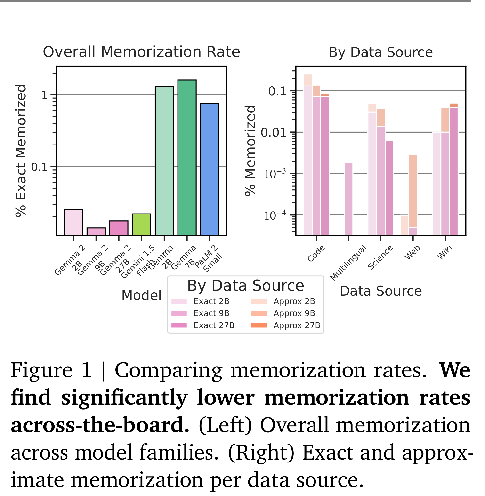

# Gemma 2 Technical Report

[Official source](https://ai.google.dev/gemma/docs/model_card_2)

## 1. Introduction

Large language models (LLMs) have demonstrated strong capabilities in language understanding, generation, and reasoning (Brown et al., 2020; Radford et al., 2019; Raffel et al., 2019). Scaling has been key to this recent progress, with many new capabilities only emerging at scale (Brown et al., 2020). The newest large models not only reach unprecedented performance on reasoning benchmarks (Achiam et al., 2023), but they also demonstrate multimodal and multilingual capabilities (Gemini Team, 2024) and even the ability to use context lengths of over 1M tokens (Gemini Team, 2024).

Small-scale models have also shown a rapid increase in performance, but these gains are largely derived from increasing the length of training (Gemma Team, 2024; Jiang et al., 2023; Touvron et al., 2023). This approach only scales logarithmically with dataset size (Hoffmann et al., 2022), and the latest small models require up to 15T tokens to improve the state of the art by less than 1-2% (AI@Meta, 2024).

Yet, these continued improvements provide evidence that small models are still under-trained. In this work, we explore alternatives to improve small model performance without solely increasing training length. One solution is to improve the quality of information received by the network at each training step by replacing the next token prediction task with a richer objective.

In particular, we focus our efforts on knowledge

distillation (Hinton et al., 2015), which replaces the one-hot vector seen at each token with the distribution of potential next tokens computed from a large model. This approach is often used to reduce the training time of smaller models by giving them richer gradients. In this work, we instead train for large quantities of tokens with distillation in order to simulate training beyond the number of available tokens. Concretely, we use a large language model as a teacher to train small models, namely 2B and 9B models, on a quantity of tokens that is more than 50× the compute-optimal quantity predicted by the theory (Hoffmann et al., 2022). Along with the models trained with distillation, we also release a 27B model trained from scratch for this work.

We also leverage several known modifications of Transformers, namely the interleaving of global and local attention layers from Beltagy et al. (2020a), and the Grouped-Query Attention (GQA) mechanism of Ainslie et al. (2023).

Overall, Gemma 2 significantly advances state-of-the-art performance relative to comparable-scale open models and are even competitive with some models more than twice their size (AI@Meta, 2024; Almazrouei et al., 2023; Jiang et al., 2023; xAI, 2024), across a variety of automated benchmarks and human evaluations. Example domains include question answering (Clark et al., 2019; Kwiatkowski et al., 2019), commonsense reasoning (Sakaguchi et al., 2019; Suzgun et al., 2022), mathematics and science (Cobbe et al., 2021; Hendrycks et al., 2020), and coding (Austin et al., 2021; Chen et al., 2021).

While thorough testing of our models has been conducted, these tests cannot cover all applications and scenarios in which Gemma 2 may be used. With this in mind, all Gemma 2 users should conduct rigorous safety testing specific to their use case before deployment or use.

In this technical report, we provide an overview of models, including the architecture, training, and pre- and post-training recipes for Gemma 2. We also provide detailed evaluations across a wide variety of quantitative and qualitative benchmarks, as well as both standard academic benchmarks and human-preference evaluations. Finally, we discuss our approach to safe and responsible deployment and outline the broader implications of Gemma 2, its limitations, and advantages.

Figure 1 | Comparing memorization rates. We find significantly lower memorization rates across-the-board. (Left) Overall memorization across model families. (Right) Exact and approximate memorization per data source.

p. 9
