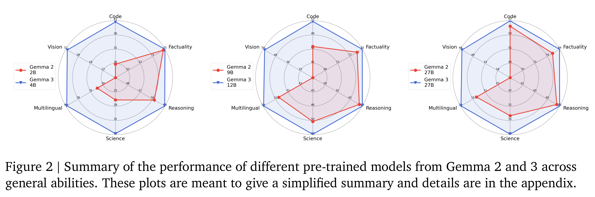
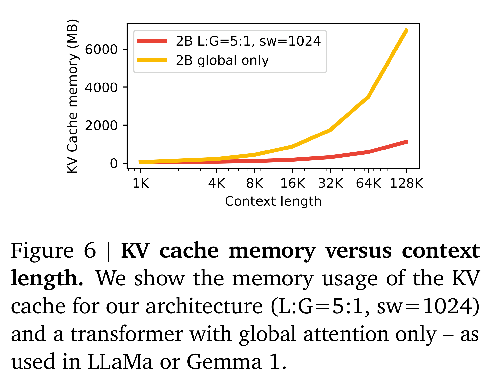

# Gemma 3 Technical Report

[Official source](https://arxiv.org/abs/2503.19786)

We introduce Gemma 3, a multimodal addition to the Gemma family of lightweight open models, ranging in scale from 1 to 27 billion parameters. This version introduces vision understanding abilities, a wider coverage of languages and longer context – at least 128K tokens. We also change the architecture of the model to reduce the KV-cache memory that tends to explode with long context. This is achieved by increasing the ratio of local to global attention layers, and keeping the span on local attention short. The Gemma 3 models are trained with distillation and achieve superior performance to Gemma 2 for both pre-trained and instruction finetuned versions. In particular, our novel post-training recipe significantly improves the math, chat, instruction-following and multilingual abilities, making Gemma3- 4B-IT competitive with Gemma2-27B-IT and Gemma3-27B-IT comparable to Gemini-1.5-Pro across benchmarks. We release all our models to the community.

Figure 2 | Summary of the performance of different pre-trained models from Gemma 2 and 3 across general abilities. These plots are meant to give a simplified summary and details are in the appendix.

p. 6

Figure 6 | KV cache memory versus context length. We show the memory usage of the KV cache for our architecture (L:G=5:1, sw=1024) and a transformer with global attention only – as used in LLaMa or Gemma 1.

p. 7
