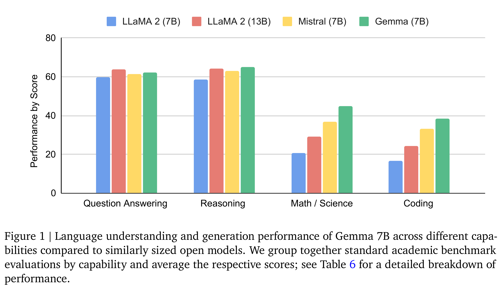
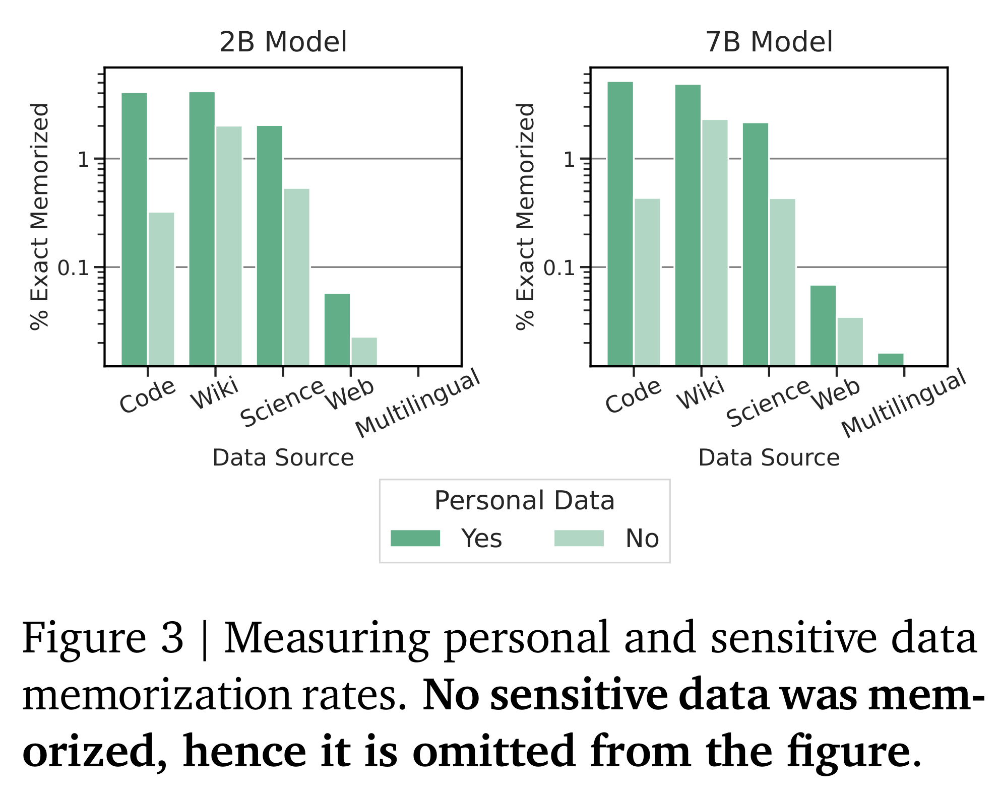

# Gemma: Open Models Based on Gemini Research and Technology

[Official source](https://arxiv.org/abs/2403.08295)

## Introduction

We present Gemma, a family of open models based on Google’s Gemini models (Gemini Team, 2023).

We trained Gemma models on up to 6T tokens of text, using architectures, data, and training recipes inspired by the Gemini model family. Like Gemini, these models achieve strong generalist ca- pabilities in text domains, alongside state-of-the- art understanding and reasoning skills at scale. With this work, we release both pre-trained and fine-tuned checkpoints, as well as an open-source codebase for inference and serving.

Gemma comes in two sizes: a 7 billion param- eter model for efficient deployment and develop- ment on GPU and TPU, and a 2 billion param- eter model for CPU and on-device applications. Each size is designed to address different compu- tational constraints, applications, and developer requirements. At each scale, we release raw, pre- trained checkpoints, as well as checkpoints fine- tuned for dialogue, instruction-following, help- fulness, and safety. We thoroughly evaluate the shortcomings of our models on a suite of quantita- tive and qualitative benchmarks. We believe the release of both pretrained and fine-tuned check- points will enable thorough research and inves- tigation into the impact of current instruction- tuning regimes, as well as the development of increasingly safe and responsible model develop- ment methodologies.

Gemma advances state-of-the-art performance relative to comparable-scale (and some larger), open models (Almazrouei et al., 2023; Jiang et al., 2023; Touvron et al., 2023a,b) across a wide range of domains including both automated benchmarks and human evaluation. Example do- mains include question answering (Clark et al., 2019; Kwiatkowski et al., 2019), commonsense reasoning (Sakaguchi et al., 2019; Suzgun et al., 2022), mathematics and science (Cobbe et al., 2021; Hendrycks et al., 2020), and coding (Austin et al., 2021; Chen et al., 2021). See complete de- tails in the Evaluation section.

Like Gemini, Gemma builds on recent work on sequence models (Sutskever et al., 2014) and transformers (Vaswani et al., 2017), deep learn- ing methods based on neural networks (LeCun et al., 2015), and techniques for large-scale train- ing on distributed systems (Barham et al., 2022; Dean et al., 2012; Roberts et al., 2023). Gemma also builds on Google’s long history of open mod- els and ecosystems, including Word2Vec (Mikolov et al., 2013), the Transformer (Vaswani et al., 2017), BERT (Devlin et al., 2018), and T5 (Raffel et al., 2019) and T5X (Roberts et al., 2022).

We believe the responsible release of LLMs is critical for improving the safety of frontier models, for ensuring equitable access to this breakthrough technology, for enabling rigorous evaluation and analysis of current techniques, and for enabling the development of the next wave of innovations. While thorough testing of all Gemma models has

been conducted, testing cannot cover all appli- cations and scenarios in which Gemma may be used. With this in mind, all Gemma users should conduct rigorous safety testing specific to their use case before deployment or use. More details on our approach to safety can be found in section Responsible Deployment.

In this technical report, we provide a detailed overview of the model architecture, training in- frastructure, and pretraining and fine-tuning recipes for Gemma, followed by thorough eval- uations of all checkpoints across a wide-variety of quantitative and qualitative benchmarks, as well as both standard academic benchmarks and human-preference evaluations. We then discuss in detail our approach to safe and responsible de- ployment. Finally, we outline the broader implica- tions of Gemma, its limitations and advantages.

Figure 1 | Language understanding and generation performance of Gemma 7B across different capa-
bilities compared to similarly sized open models. We group together standard academic benchmark
evaluations by capability and average the respective scores; see Table 6 for a detailed breakdown of
performance.

p. 2

Figure 3 | Measuring personal and sensitive data
memorization rates. No sensitive data was mem-
orized, hence it is omitted from the figure.

p. 7
