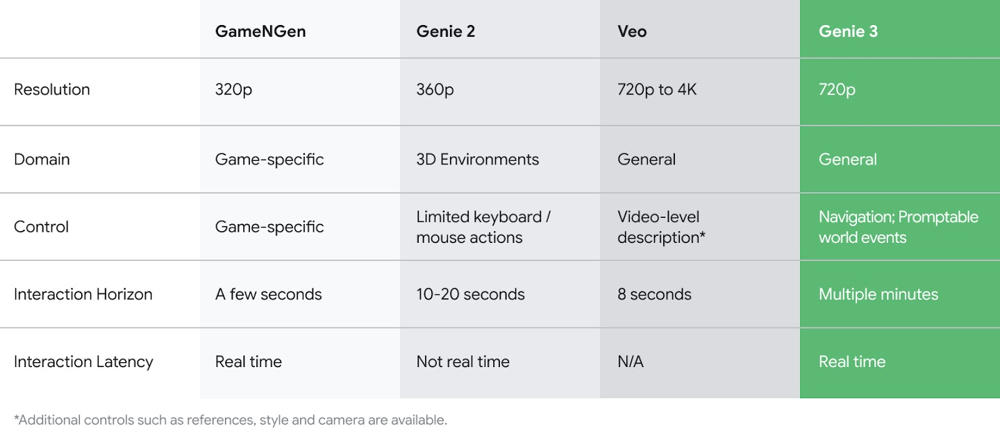

# Genie 3

[Official source](https://deepmind.google/blog/genie-3-a-new-frontier-for-world-models/)

Today we are announcing Genie 3, a general purpose world model that can generate an unprecedented diversity of interactive environments.

Given a text prompt, Genie 3 can generate dynamic worlds that you can navigate in real time at 24 frames per second, retaining consistency for a few minutes at a resolution of 720p.

