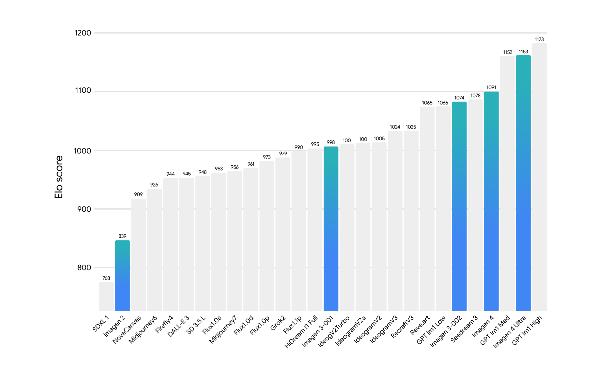

# Imagen 4 Model Card

[Official source](https://storage.googleapis.com/deepmind-media/Model-Cards/Imagen-4-Model-Card.pdf)

## Description:

Imagen 4 is a latent diffusion model that generates high quality images from text prompts. Imagen 4 performs well in photorealistic composition settings and has improved spelling and typography, instruction following and richer colors, textures and details compared to previous Imagen models.

Human evaluation on GenAI-Bench: Elo scores - a high overall preference benchmark for Imagen 4 vs other models. 3

p. 4
