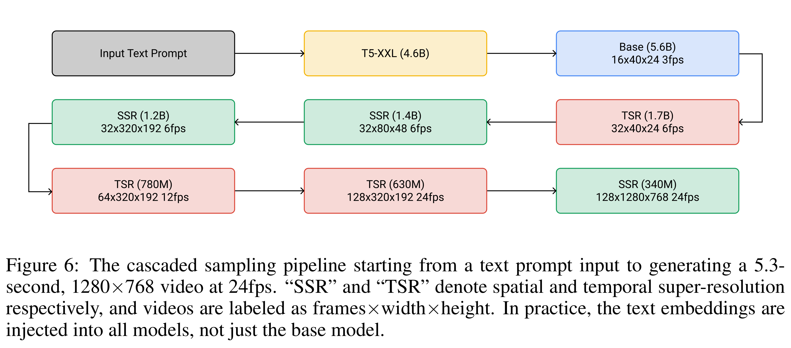
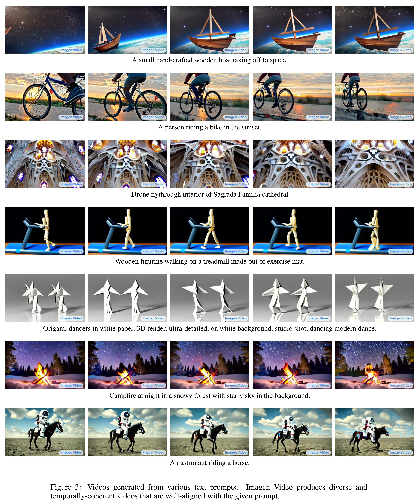

# Imagen Video: High Definition Video Generation with Diffusion Models

[Official source](https://arxiv.org/abs/2210.02303)

## ABSTRACT

We present Imagen Video, a text-conditional video generation system based on a cascade of video diffusion models. Given a text prompt, Imagen Video generates high definition videos using a base video generation model and a sequence of in- terleaved spatial and temporal video super-resolution models. We describe how we scale up the system as a high definition text-to-video model including design decisions such as the choice of fully-convolutional temporal and spatial super- resolution models at certain resolutions, and the choice of the v-parameterization of diffusion models. In addition, we confirm and transfer findings from previous work on diffusion-based image generation to the video generation setting. Fi- nally, we apply progressive distillation to our video models with classifier-free guidance for fast, high quality sampling. We find Imagen Video not only capable of generating videos of high fidelity, but also having a high degree of controlla- bility and world knowledge, including the ability to generate diverse videos and text animations in various artistic styles and with 3D object understanding. See imagen.research.google/video for samples.

Figure 6: The cascaded sampling pipeline starting from a text prompt input to generating a 5.3- second, 1280×768 video at 24fps. “SSR” and “TSR” denote spatial and temporal super-resolution respectively, and videos are labeled as frames×width×height. In practice, the text embeddings are injected into all models, not just the base model.

p. 8

Figure 3: Videos generated from various text prompts. Imagen Video produces diverse and temporally-coherent videos that are well-aligned with the given prompt.

p. 3
