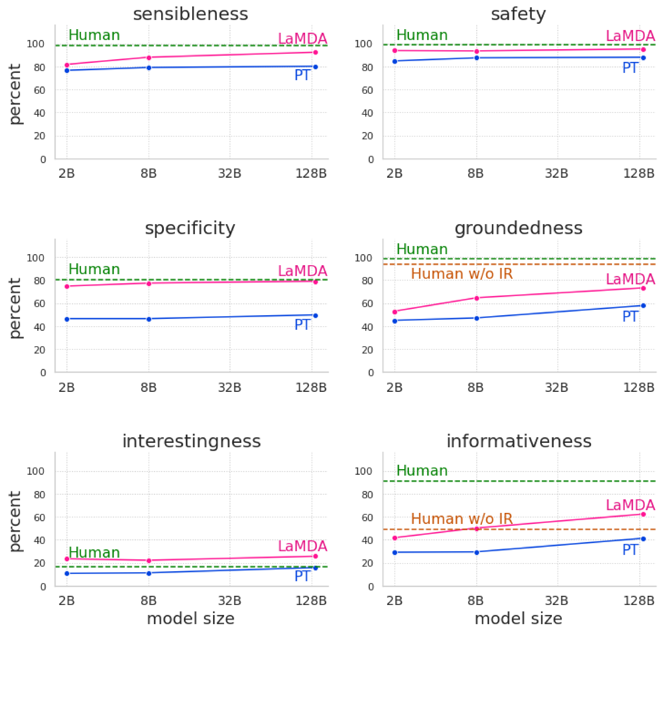

# LaMDA: Language Models for Dialog Applications

[Official source](https://arxiv.org/abs/2201.08239)

## Abstract

We present LaMDA: Language Models for Dialog Applications. LaMDA is a family of Transformer-based neural language models specialized for dialog, which have up to 137B parameters and are pre-trained on 1.56T words of public dialog data and web text. While model scaling alone can improve quality, it shows less improvements on safety and factual grounding. We demonstrate that fine-tuning with annotated data and enabling the model to consult external knowledge sources can lead to significant improvements towards the two key challenges of safety and factual grounding. The first challenge, safety, involves ensuring that the model’s responses are consistent with a set of human values, such as preventing harmful suggestions and unfair bias. We quantify safety using a metric based on an illustrative set of human values, and we find that filtering candidate responses using a LaMDA classifier fine-tuned with a small amount of crowdworker-annotated data offers a promising approach to improving model safety. The second challenge, factual grounding, involves enabling the model to consult external knowledge sources, such as an information retrieval system, a language translator, and a calculator. We quantify factuality using a groundedness metric, and we find that our approach enables the model to generate responses grounded in known sources, rather than responses that merely sound plausible. Finally, we explore the use of LaMDA in the domains of education and content recommendations, and analyze their helpfulness and role consistency.

Figure 4: Effects of model scaling and fine-tuning on six foundation metrics. We show results for 2B, 8B and 137B parameters pre-trained (PT) and fine-tuned (LaMDA) models, and compare them with results for crowdworker with access to information retrieval tools (‘Human’), and without access to information retrieval tools (‘Human w/o IR’).

p. 12
