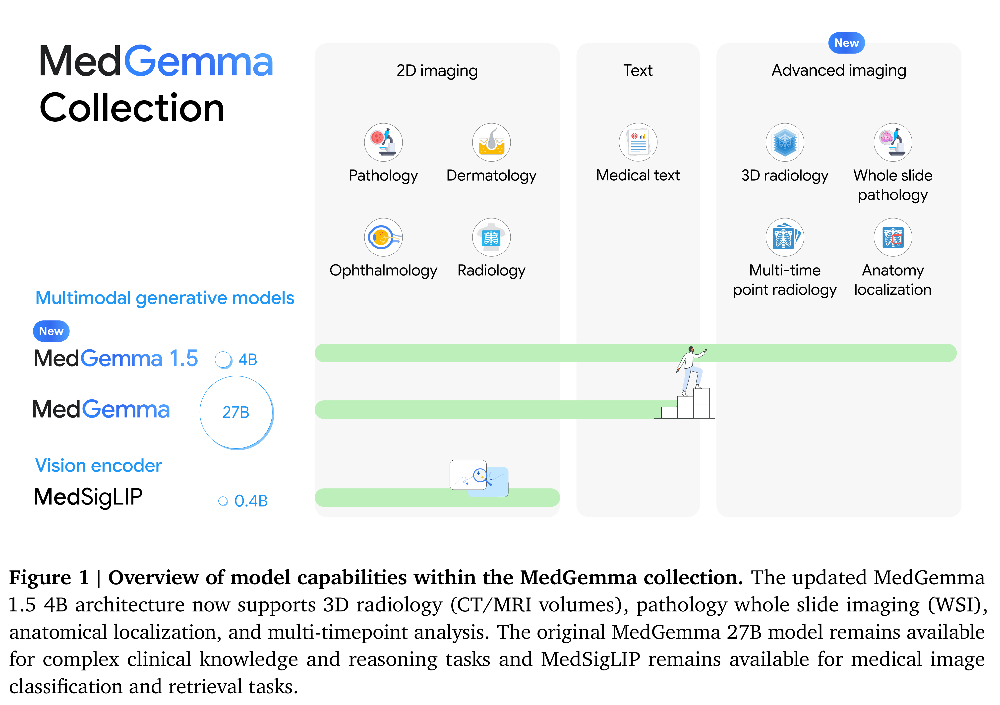
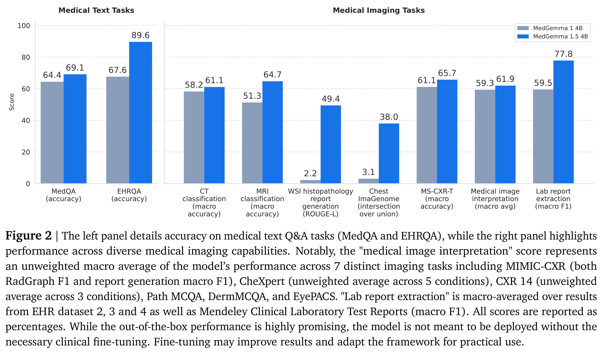

# MedGemma 1.5 Technical Report

[PDF](../../pdfs/google/technical-reports/medgemma-1-5-technical-report--arxiv-v2.pdf#page=1) · [Official source](https://arxiv.org/abs/2604.05081)

We introduce MedGemma 1.5 4B, the latest model in the MedGemma collection. MedGemma 1.5 expands on MedGemma 1 by integrating additional capabilities: high-dimensional medical imaging (CT/MRI volumes and histopathology whole slide images), anatomical localization via bounding boxes, multi-timepoint chest X-ray analysis, and improved medical document understanding (lab reports, electronic health records). We detail the innovations required to enable these modalities within a single architecture, including new training data, long-context 3D volume slicing, and whole-slide pathology sampling. Compared to MedGemma 1 4B, MedGemma 1.5 4B demonstrates significant gains in these new areas, improving 3D MRI condition classification accuracy by 11% and 3D CT condition classification by 3% (absolute improvements). In whole slide pathology imaging, MedGemma 1.5 4B achieves a 47% macro F1 gain. Additionally, it improves anatomical localization with a 35% increase in Intersection over Union on chest X-rays and achieves a 4% macro accuracy for longitudinal (multi-timepoint) chest x-ray analysis. Beyond its improved multimodal performance over MedGemma 1, MedGemma 1.5 improves on text-based clinical knowledge and reasoning, improving by 5% on MedQA accuracy and 22% on EHRQA accuracy. It also achieves an average of 18% macro F1 on 4 different lab report information extraction datasets (EHR Datasets 2, 3, 4, and Mendeley Clinical Laboratory Test Reports). Taken together, MedGemma 1.5 serves as a robust, open resource for the community, designed as an improved foundation on which developers can create the next generation of medical AI systems. Resources and tutorials for building upon MedGemma 1.5 can be found at https://goo.gle/medgemma.

Figure 1 | Overview of model capabilities within the MedGemma collection. The updated MedGemma
1.5 4B architecture now supports 3D radiology (CT/MRI volumes), pathology whole slide imaging (WSI),
anatomical localization, and multi-timepoint analysis. The original MedGemma 27B model remains available
for complex clinical knowledge and reasoning tasks and MedSigLIP remains available for medical image
classification and retrieval tasks.

[p. 2](../../pdfs/google/technical-reports/medgemma-1-5-technical-report--arxiv-v2.pdf#page=2) · [PDF](../../figures/google/medgemma-1-5-technical-report/figure-01.pdf)

Figure 2 | The left panel details accuracy on medical text Q&A tasks (MedQA and EHRQA), while the right panel highlights
performance across diverse medical imaging capabilities. Notably, the "medical image interpretation" score represents
an unweighted macro average of the model’s performance across 7 distinct imaging tasks including MIMIC-CXR (both
RadGraph F1 and report generation macro F1), CheXpert (unweighted average across 5 conditions), CXR 14 (unweighted
average across 3 conditions), Path MCQA, DermMCQA, and EyePACS. "Lab report extraction" is macro-averaged over results
from EHR dataset 2, 3 and 4 as well as Mendeley Clinical Laboratory Test Reports (macro F1). All scores are reported as
percentages. While the out-of-the-box performance is highly promising, the model is not meant to be deployed without the
necessary clinical fine-tuning. Fine-tuning may improve results and adapt the framework for practical use.

[p. 3](../../pdfs/google/technical-reports/medgemma-1-5-technical-report--arxiv-v2.pdf#page=3) · [PDF](../../figures/google/medgemma-1-5-technical-report/figure-02.pdf)
