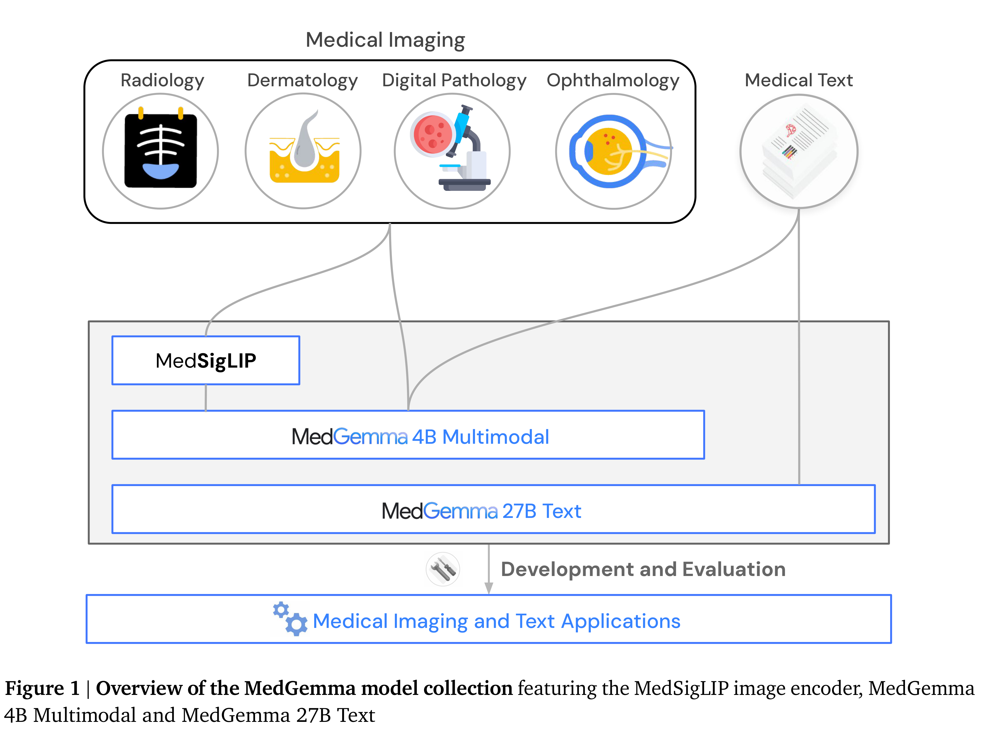
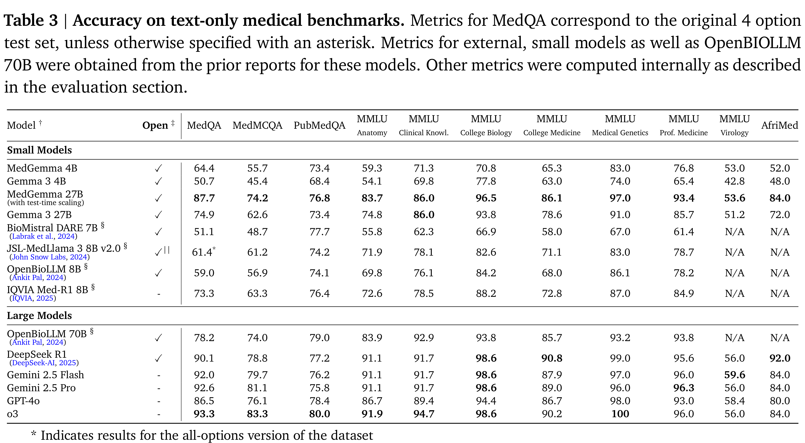

# MedGemma Technical Report

[Official source](https://arxiv.org/abs/2507.05201)

## 1. Introduction

The landscape of modern healthcare is characterized by the generation and use of an unprecedented volume and diversity of data. Diagnosis, treatment, and monitoring rely on synthesizing information from disparate sources and specialties. Recently developed large multimodal models (LMMs), trained on massive and diverse datasets, exhibit remarkable capabilities in detecting complex patterns, generating coherent text, and processing visual information (Achiam et al., 2023; Alayrac et al., 2022; Chen et al., 2022; Liu et al., 2023, 2024; OpenAI, 2023; Touvron et al., 2023). These capabilities mark a potential paradigm shift in assisting with current workflows and extracting novel insights.

While general-purpose (non-medically tuned) LMMs demonstrate impressively broad abilities, generic models can lack nuanced medical understanding and the ability to interpret and reason about medical data in a robust way (Han et al., 2023; Labrak et al., 2024; Singhal et al., 2023b,c; Toma et al., 2023; Tu et al., 2024; Yang et al., 2024). Recognizing this gap, we created MedGemma, a new suite of open, medically-tuned, vision-language foundation models. These models represent the latest addition to the Health AI Developer Foundations (Kiraly et al., 2024) collection. Built upon the robust architecture of Gemma 3 (Gemma-Team et al., 2025), the MedGemma models are designed to interpret and reason about medical images and text while retaining the strong general-purpose capabilities present in Gemma 3.

In this report, we focus on two MedGemma models: a 4B variant that can accept text, images, or both as input, and a 27B variant that is optimized for text-only inputs. Both models output text. MedGemma 4B demonstrates strong performance on Vision Question Answering (VQA) benchmarks compared to prior SOTA models like Med-Gemini (Saab et al., 2024; Yang et al., 2024) despite being considerably smaller. Both MedGemma 4B and 27B are highly competitive on challenging

text-only medical benchmark tasks, including MedQA (Jin et al., 2021), MedMCQA (Pal et al., 2022), PubMedQA (Jin et al., 2019), MMLU Med (Hendrycks et al., 2020), AfriMed-QA (Olatunji et al., 2024), and AgentClinic (Schmidgall et al., 2024) when compared against other open models of similar scale. In addition to these strong out-of-the-box capabilities, we show how performance can be further improved by fine-tuning MedGemma on subdomains like chest X-ray reporting, histopathology classification, and electronic health record information retrieval.

An additional MedGemma variant, a multimodal version of MedGemma 27B, was also developed and is being released along with the other models. More thorough evaluation of this multimodal 27B variant is ongoing and preliminary results can be found in Appendix Section F. Unless otherwise noted in this report, evaluations that reference “MedGemma 27B” refer to the text-only variant of MedGemma 27B.

In addition to the MedGemma models, we describe the standalone MedSigLIP 400M-parameter medical image encoder. MedSigLIP is based on SigLIP-400M (Zhai et al., 2023) and is the same encoder that powers MedGemma’s image interpretation capabilities. When used on its own, MedSigLIP enables data-efficient and zero-shot image classification and retrieval, with performance comparable to or exceeding specialized image encoders.

A high level overview of the released models is shown in Fig. 1. More details about the MedGemma collection, including tutorials and links to download all of the above models, can be found at https: //goo.gle/medgemma.

Figure 1 | Overview of the MedGemma model collection featuring the MedSigLIP image encoder, MedGemma
4B Multimodal and MedGemma 27B Text

p. 2

Table 3 | Accuracy on text-only medical benchmarks. Metrics for MedQA correspond to the original 4 option
test set, unless otherwise specified with an asterisk. Metrics for external, small models as well as OpenBIOLLM
70B were obtained from the prior reports for these models. Other metrics were computed internally as described
in the evaluation section.

p. 9
