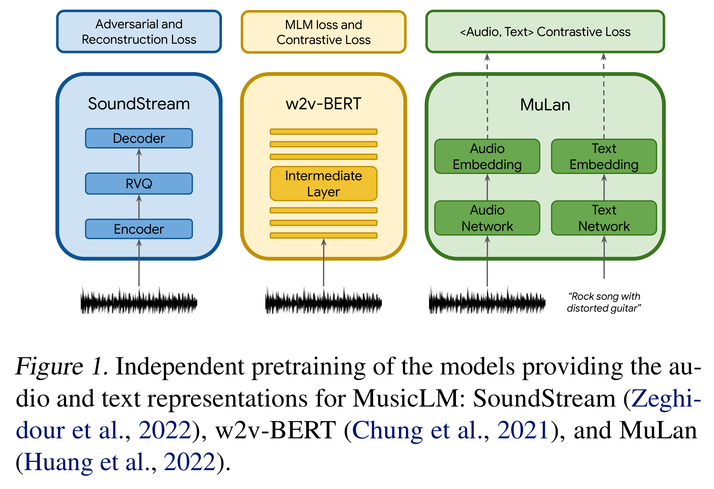
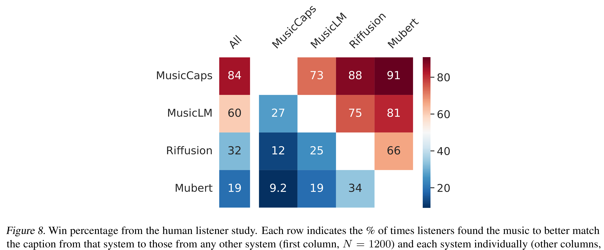

# MusicLM: Generating Music From Text

[Official source](https://arxiv.org/abs/2301.11325)

## Abstract

We introduce MusicLM, a model for generating high-fidelity music from text descriptions such as “a calming violin melody backed by a distorted guitar riff”. MusicLM casts the process of conditional music generation as a hierarchical sequence-to-sequence modeling task, and it generates music at 24 kHz that remains consistent over several minutes. Our experiments show that MusicLM outperforms previous systems both in audio quality and adherence to the text descriptions. Moreover, we demonstrate that MusicLM can be conditioned on both text and a melody in that it can transform whistled and hummed melodies according to the style described in a text caption. To support future research, we publicly release MusicCaps, a dataset composed of 5.5k music-text pairs, with rich text descriptions provided by human experts. google-research.github.io/seanet/musiclm/examples

Figure 1. Independent pretraining of the models providing the au-

p. 4

Figure 8. Win percentage from the human listener study. Each row indicates the % of times listeners found the music to better match

p. 15
