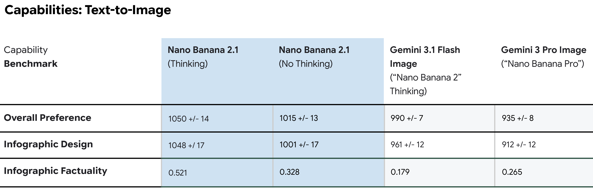
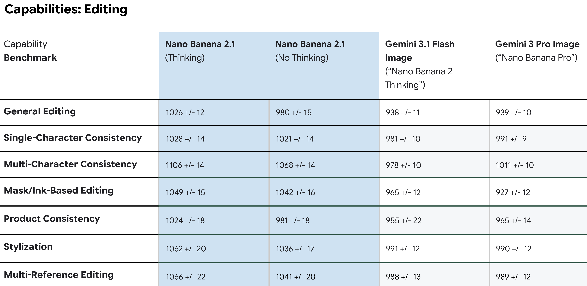

# Nano Banana 2.1 Model Card

[Official source](https://deepmind.google/models/model-cards/nano-banana-2-1/)

## Description

Nano Banana 2.1 is a member of the Gemini 3 series of models, a suite of highly-capable, natively multimodal reasoning models. Nano Banana 2.1 can comprehend input from different information sources, including text and images. Image and text output is generated in the response.

## Human Red Teaming Results

We conduct manual red teaming by specialist teams who sit outside of the model development team. High-level findings are fed back to the model team.

p. 7

Capabilities: Text-to-Image

p. 5

Capabilities: Editing

p. 5
