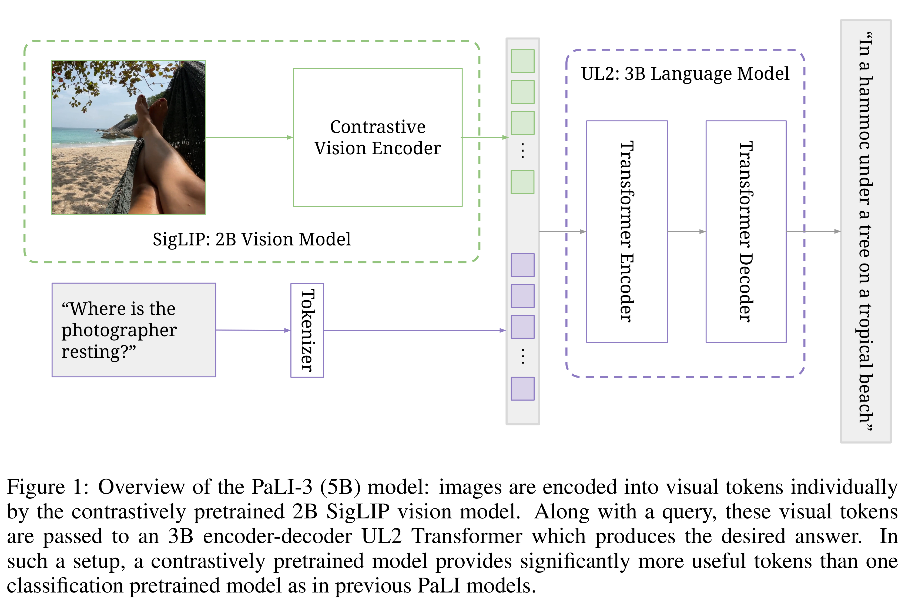
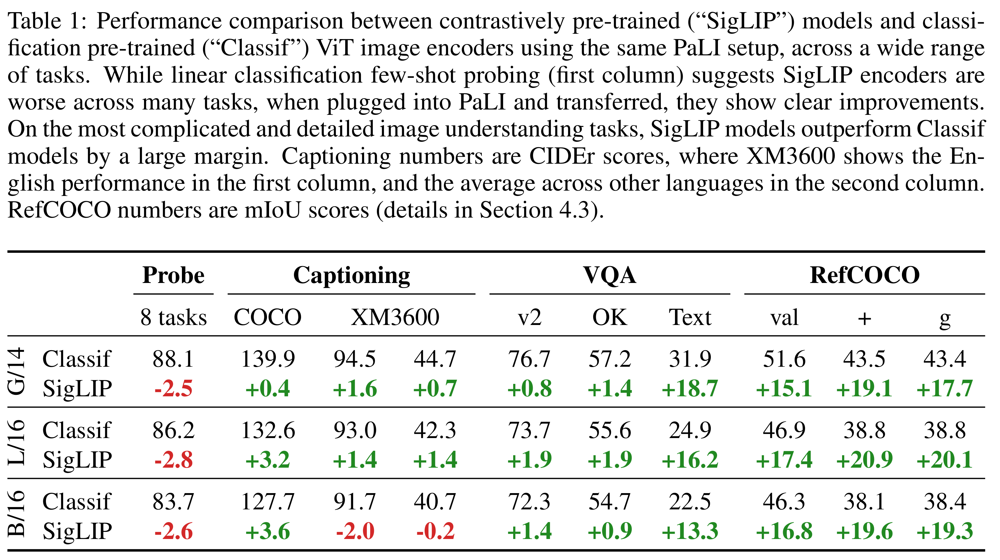

# PaLI-3 Vision Language Models: Smaller, Faster, Stronger

[Official source](https://arxiv.org/abs/2310.09199)

## ABSTRACT

This paper presents PaLI-3, a smaller, faster, and stronger vision language model (VLM) that compares favorably to similar models that are 10x larger. As part of arriving at this strong performance, we compare Vision Transformer (ViT) mod- els pretrained using classification objectives to contrastively (SigLIP) pretrained ones. We find that, while slightly underperforming on standard image classifica- tion benchmarks, SigLIP-based PaLI shows superior performance across various multimodal benchmarks, especially on localization and visually-situated text un- derstanding. We scale the SigLIP image encoder up to 2 billion parameters, and achieves a new state-of-the-art on multilingual cross-modal retrieval. We hope that PaLI-3, at only 5B parameters, rekindles research on fundamental pieces of complex VLMs, and could fuel a new generation of scaled-up models.

Figure 1: Overview of the PaLI-3 (5B) model: images are encoded into visual tokens individually
by the contrastively pretrained 2B SigLIP vision model. Along with a query, these visual tokens
are passed to an 3B encoder-decoder UL2 Transformer which produces the desired answer. In
such a setup, a contrastively pretrained model provides significantly more useful tokens than one
classification pretrained model as in previous PaLI models.

p. 3

Table 1: Performance comparison between contrastively pre-trained (“SigLIP”) models and classi-
fication pre-trained (“Classif”) ViT image encoders using the same PaLI setup, across a wide range
of tasks. While linear classification few-shot probing (first column) suggests SigLIP encoders are
worse across many tasks, when plugged into PaLI and transferred, they show clear improvements.
On the most complicated and detailed image understanding tasks, SigLIP models outperform Classif
models by a large margin. Captioning numbers are CIDEr scores, where XM3600 shows the En-
glish performance in the first column, and the average across other languages in the second column.
RefCOCO numbers are mIoU scores (details in Section 4.3).

p. 4
