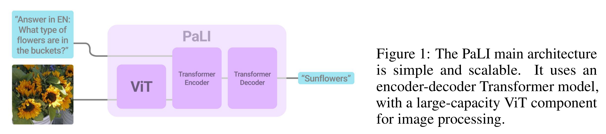
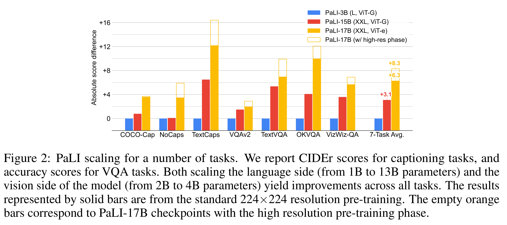

# PaLI: A Jointly-Scaled Multilingual Language-Image Model

[Official source](https://arxiv.org/abs/2209.06794)

## ABSTRACT

Effective scaling and a flexible task interface enable large language models to excel at many tasks. We present PaLI (Pathways Language and Image model), a model that extends this approach to the joint modeling of language and vision. PaLI generates text based on visual and textual inputs, and with this interface performs many vision, language, and multimodal tasks, in many languages. To train PaLI, we make use of large pre-trained encoder-decoder language models and Vision Transformers (ViTs). This allows us to capitalize on their existing capabilities and leverage the substantial cost of training them. We find that joint scaling of the vision and language components is important. Since existing Transformers for language are much larger than their vision counterparts, we train a large, 4-billion parameter ViT (ViT-e) to quantify the benefits from even larger-capacity vision models. To train PaLI, we create a large multilingual mix of pre-training tasks, based on a new image-text training set containing 10B images and texts in over 100 languages. PaLI achieves state-of-the-art in multiple vision and language tasks (such as captioning, visual question-answering, scene-text understanding), while retaining a simple, modular, and scalable design.

Figure 1: The PaLI main architecture
is simple and scalable.
It uses an
encoder-decoder Transformer model,
with a large-capacity ViT component
for image processing.

p. 4

Figure 2: PaLI scaling for a number of tasks. We report CIDEr scores for captioning tasks, and
accuracy scores for VQA tasks. Both scaling the language side (from 1B to 13B parameters) and the
vision side of the model (from 2B to 4B parameters) yield improvements across all tasks. The results
represented by solid bars are from the standard 224×224 resolution pre-training. The empty orange
bars correspond to PaLI-17B checkpoints with the high resolution pre-training phase.

p. 8
