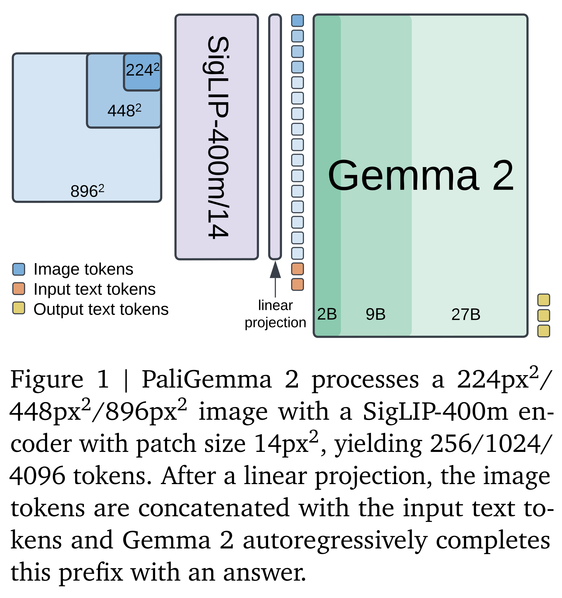
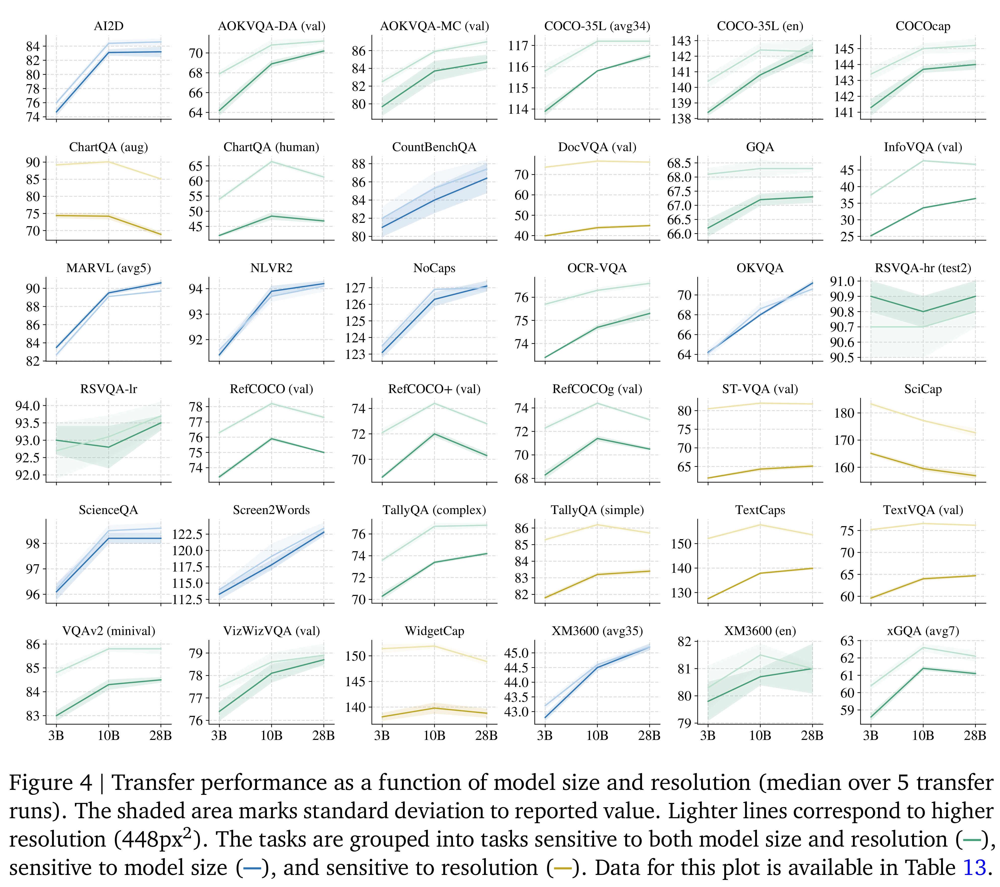

# PaliGemma 2: A Family of Versatile VLMs for Transfer

[Official source](https://arxiv.org/abs/2412.03555)

## 1. Introduction

PaliGemma [9] is a 3B vision-language model (VLM) for transfer combining the SigLIP [108] vision encoder and the 2B Gemma language model [21]. It matches the performance of much larger prior VLMs consisting of a range of different vision encoders and language models. We now upgrade PaliGemma by replacing its language model component with the more recent and more capable language models from the Gemma 2 fam- ily [22], producing new PaliGemma 2 base VLMs at 3 different sizes (3B, 10B, 28B) and 3 different resolutions (224px2, 448px2, 896px2). To equip these VLMs with broad capabilities we use the same 3-stage training recipe as PaliGemma. The resulting models are designed to be fine-tuned, and when evaluated on the 30+ transfer tasks considered in [9] (which include common cap- tioning and VQA tasks, and some video and re- ferring expression tasks), PaliGemma 2 slightly outperforms PaliGemma at the same resolution and model size, and obtains substantial improve- ments at larger model sizes. We release the PaliGemma 2 VLMs as open-weight models which can serve as drop-in replacement for PaliGemma.

Having a family of models at hand that are all derived from comparable building blocks and are trained according to the same recipe allows us to analyze the effect of model size and resolution on the downstream performance in a controlled setting (see Sec. 4.1). For example, while almost every task benefits from added compute, we iden- tify which transfer tasks benefit more from com- pute due to increased resolutions, and which from compute due to a larger, more capable language model. We also show that larger models tend to have a lower optimal transfer learning rate.

We also explore new tasks which were not ex- plored in depth in [9], including text detection and recognition (Sec. 4.2), table structure recog- nition (Sec. 4.3), molecular structure recogni- tion (Sec. 4.4), optical music score recognition (Sec. 4.5), long caption generation (Sec. 4.6), spa- tial reasoning (Sec. 4.7), and radiography report generation (Sec. 4.8). PaliGemma 2 obtains state- of-the-art results on many of those tasks. Finally, we benchmark and analyze low-precision vari- ants of PaliGemma 2 for on-device deployment on CPU (Sec. 4.9).

Figure 1 | PaliGemma 2 processes a 224px2/
448px2/896px2 image with a SigLIP-400m en-
coder with patch size 14px2, yielding 256/1024/
4096 tokens. After a linear projection, the image
tokens are concatenated with the input text to-
kens and Gemma 2 autoregressively completes
this prefix with an answer.

p. 2

Figure 4 | Transfer performance as a function of model size and resolution (median over 5 transfer
runs). The shaded area marks standard deviation to reported value. Lighter lines correspond to higher
resolution (448px2). The tasks are grouped into tasks sensitive to both model size and resolution ( ),
sensitive to model size ( ), and sensitive to resolution ( ). Data for this plot is available in Table 13.

p. 5
