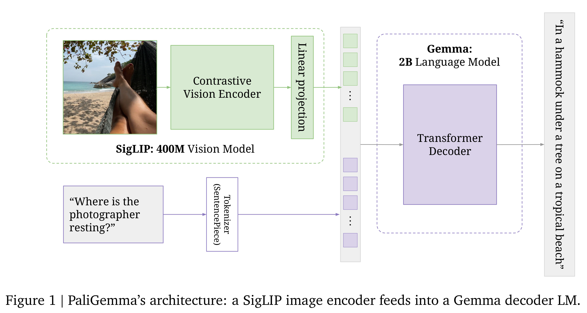
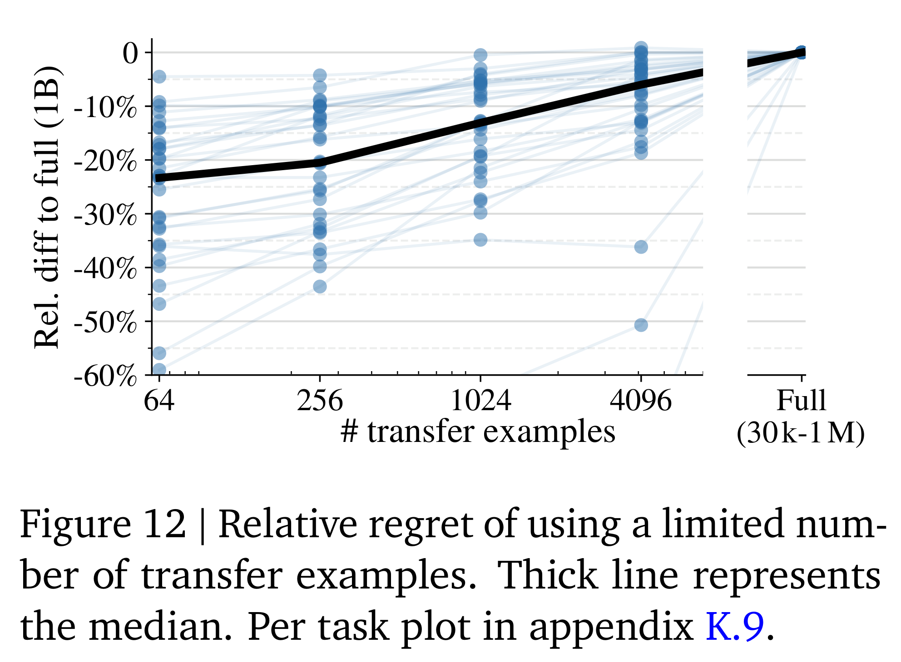

# PaliGemma: A versatile 3B VLM for transfer

[Official source](https://arxiv.org/abs/2407.07726)

## 1. Introduction

PaliGemma is an open model, continuing the line of PaLI vision-language models in a combination with the Gemma family of language models.

PaLI is a series of state-of-the-art vision- language models, starting with the first PaLI [23] showing promising scaling results up to 17 B, using classification pretrained ViT [131] and mT5 [126] language model. PaLI-X [24] and PaLM-E [36] then pushed this further, combin- ing ViT-22 B [29] and a 32 B UL2 [104] language model or the 540 B PaLM [28] language model, respectively, and getting further increased perfor- mance on vision-language tasks, albeit saturating performance on standard image classification and retrieval tasks. Finally, PaLI-3 [25] demonstrates that through better pretraining with SigLIP [133] and more careful multimodal data curation, a 2 B vision and 3 B language model (i.e. a 5 B vision- language model) matches the 10x larger PaLI-X and 100x larger PaLM-E across most benchmarks.

PaliGemma continues this trend, combining the 400 M SigLIP and the 2 B Gemma models [82] into a sub-3 B VLM that still maintains perfor- mance comparable to PaLI-X, PaLM-E, and PaLI-3.

Gemma [82] is a family of auto-regressive decoder-only open large language models built from the same research and technology used to create the Gemini [7] models. The models come in different sizes (2 B, 7 B), both pretrained and instruction fine-tuned. PaliGemma uses the 2 B pretrained version.

The main goal of our work is to provide a versatile base VLM. Hence, we show that it reaches state-of-the-art results not only on stan- dard COCO captions, VQAv2, InfographicVQA and others, but also on more exotic Remote- Sensing VQA, TallyVQA, several video caption- ing and QA tasks, as well as referring expression segmentation (see full task list in Appendix B).

Figure 1 | PaliGemma’s architecture: a SigLIP image encoder feeds into a Gemma decoder LM.

p. 2

Figure 12 | Relative regret of using a limited num- ber of transfer examples. Thick line represents the median. Per task plot in appendix K.9.

p. 13
