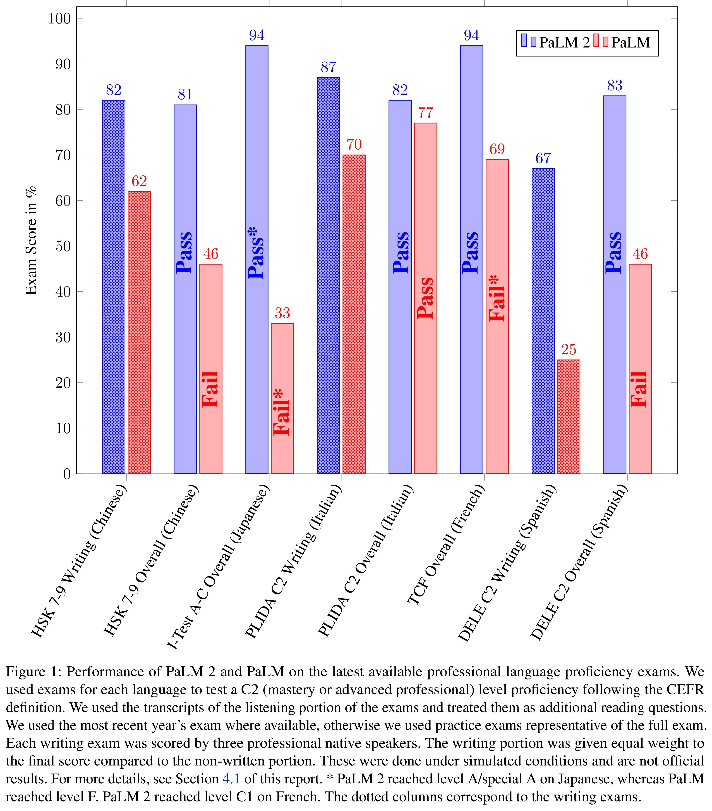
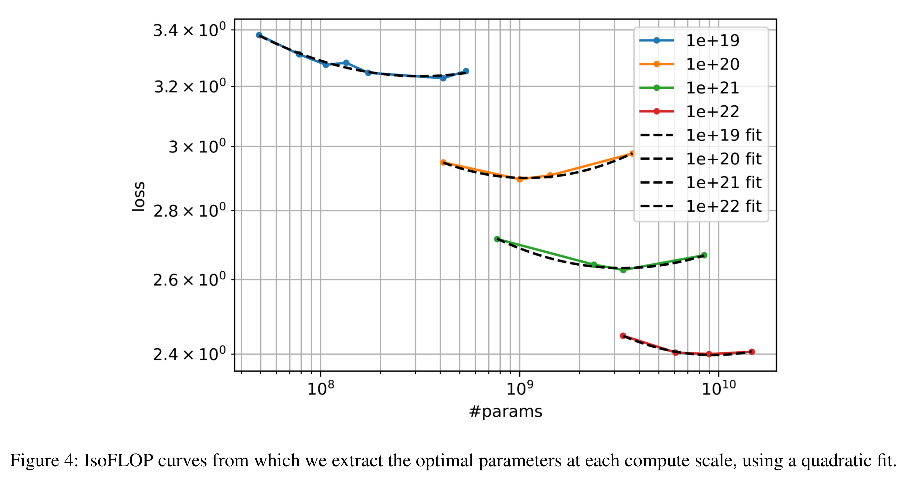

# PaLM 2 Technical Report

[Official source](https://arxiv.org/abs/2305.10403)

## Abstract

We introduce PaLM 2, a new state-of-the-art language model that has better multilingual and reasoning capabilities and is more compute-efficient than its predecessor PaLM. PaLM 2 is a Transformer-based model trained using a mixture of objectives. Through extensive evaluations on English and multilingual language, and reasoning tasks, we demonstrate that PaLM 2 has significantly improved quality on downstream tasks across different model sizes, while simultaneously exhibiting faster and more efficient inference compared to PaLM. This improved efficiency enables broader deployment while also allowing the model to respond faster, for a more natural pace of interaction. PaLM 2 demonstrates robust reasoning capabilities exemplified by large improvements over PaLM on BIG-Bench and other reasoning tasks. PaLM 2 exhibits stable performance on a suite of responsible AI evaluations, and enables inference-time control over toxicity without additional overhead or impact on other capabilities. Overall, PaLM 2 achieves state-of-the-art performance across a diverse set of tasks and capabilities.

When discussing the PaLM 2 family, it is important to distinguish between pre-trained models (of various sizes), fine-tuned variants of these models, and the user-facing products that use these models. In particular, user-facing products typically include additional pre- and post-processing steps. Additionally, the underlying models may evolve over time. Therefore, one should not expect the performance of user-facing products to exactly match the results reported in this report.

Figure 1: Performance of PaLM 2 and PaLM on the latest available professional language proficiency exams. We
used exams for each language to test a C2 (mastery or advanced professional) level proficiency following the CEFR
definition. We used the transcripts of the listening portion of the exams and treated them as additional reading questions.
We used the most recent year’s exam where available, otherwise we used practice exams representative of the full exam.
Each writing exam was scored by three professional native speakers. The writing portion was given equal weight to
the final score compared to the non-written portion. These were done under simulated conditions and are not official
results. For more details, see Section 4.1 of this report. * PaLM 2 reached level A/special A on Japanese, whereas PaLM
reached level F. PaLM 2 reached level C1 on French. The dotted columns correspond to the writing exams.

p. 4

Figure 4: IsoFLOP curves from which we extract the optimal parameters at each compute scale, using a quadratic fit.

p. 7
