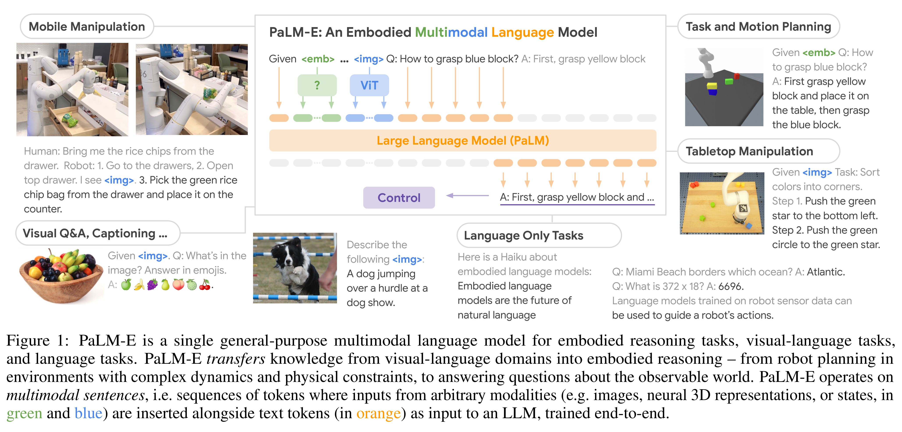

# PaLM-E: An Embodied Multimodal Language Model

[Official source](https://arxiv.org/abs/2303.03378)

## Abstract

Large language models have been demonstrated to perform complex tasks. However, enabling general inference in the real world, e.g. for robotics problems, raises the challenge of grounding. We propose embodied language models to di- rectly incorporate real-world continuous sensor modalities into language models and thereby establish the link be- tween words and percepts. Input to our embodied language model are multi-modal sentences that interleave visual, con- tinuous state estimation, and textual input encodings. We train these encodings end-to-end, in conjunction with a pre- trained large language model, for multiple embodied tasks including sequential robotic manipulation planning, visual question answering, and captioning. Our evaluations show that PaLM-E, a single large embodied multimodal model, can address a variety of embodied reasoning tasks, from a variety of observation modalities, on multiple embodiments, and further, exhibits positive transfer: the model benefits from diverse joint training across internet-scale language, vision, and visual-language domains. Our largest model, PaLM-E-562B with 562B parameters, in addition to being trained on robotics tasks, is a visual-language generalist with state-of-the-art performance on OK-VQA, and retains generalist language capabilities with increasing scale.

Figure 1: PaLM-E is a single general-purpose multimodal language model for embodied reasoning tasks, visual-language tasks,
and language tasks. PaLM-E transfers knowledge from visual-language domains into embodied reasoning – from robot planning in
environments with complex dynamics and physical constraints, to answering questions about the observable world. PaLM-E operates on
multimodal sentences, i.e. sequences of tokens where inputs from arbitrary modalities (e.g. images, neural 3D representations, or states, in
green and blue) are inserted alongside text tokens (in orange) as input to an LLM, trained end-to-end.

p. 1
