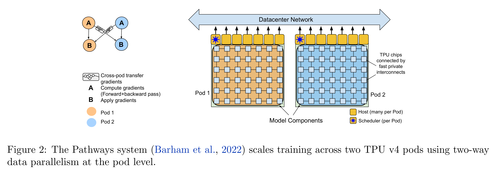

# PaLM: Scaling Language Modeling with Pathways

[Official source](https://arxiv.org/abs/2204.02311)

## Abstract

Large language models have been shown to achieve remarkable performance across a variety of natural language tasks using few-shot learning, which drastically reduces the number of task-specific training examples needed to adapt the model to a particular application. To further our understanding of the impact of scale on few-shot learning, we trained a 540-billion parameter, densely activated, Transformer language model, which we call Pathways Language Model (PaLM).

We trained PaLM on 6144 TPU v4 chips using Pathways, a new ML system which enables highly efficient training across multiple TPU Pods. We demonstrate continued benefits of scaling by achieving state-of-the-art few-shot learning results on hundreds of language understanding and generation benchmarks. On a number of these tasks, PaLM 540B achieves breakthrough performance, outperforming the finetuned state-of-the-art on a suite of multi-step reasoning tasks, and outperforming average human performance on the recently released BIG-bench benchmark. A significant number of BIG-bench tasks showed discontinuous improvements from model scale, meaning that performance steeply increased as we scaled to our largest model. PaLM also has strong capabilities in multilingual tasks and source code generation, which we demonstrate on a wide array of benchmarks. We additionally provide a comprehensive analysis on bias and toxicity, and study the extent of training data memorization with respect to model scale. Finally, we discuss the ethical considerations related to large language models and discuss potential mitigation strategies.

Figure 2: The Pathways system (Barham et al., 2022) scales training across two TPU v4 pods using two-way data parallelism at the pod level.

p. 8
