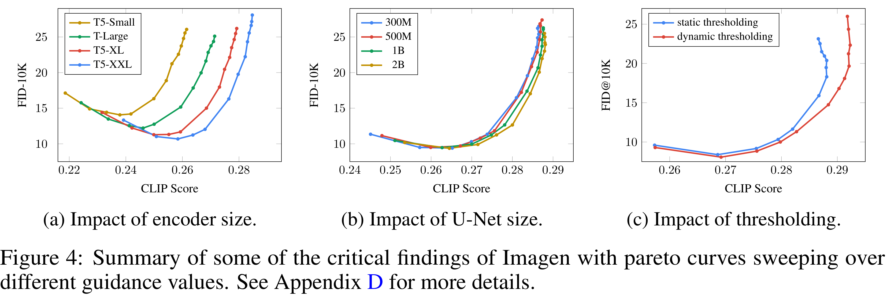

# Photorealistic Text-to-Image Diffusion Models with Deep Language Understanding

[Official source](https://arxiv.org/abs/2205.11487)

## Abstract

We present Imagen, a text-to-image diffusion model with an unprecedented degree of photorealism and a deep level of language understanding. Imagen builds on the power of large transformer language models in understanding text and hinges on the strength of diffusion models in high-fidelity image generation. Our key discovery is that generic large language models (e.g. T5), pretrained on text-only corpora, are surprisingly effective at encoding text for image synthesis: increasing the size of the language model in Imagen boosts both sample fidelity and image-text alignment much more than increasing the size of the image diffusion model. Imagen achieves a new state-of-the-art FID score of 7.27 on the COCO dataset, without ever training on COCO, and human raters find Imagen samples to be on par with the COCO data itself in image-text alignment. To assess text-to-image models in greater depth, we introduce DrawBench, a comprehensive and challenging benchmark for text-to-image models. With DrawBench, we compare Imagen with recent methods including VQ-GAN+CLIP, Latent Diffusion Models, GLIDE and DALL-E 2, and find that human raters prefer Imagen over other models in side-by-side comparisons, both in terms of sample quality and image-text alignment. See imagen.research.google for an overview of the results.

Figure 4: Summary of some of the critical findings of Imagen with pareto curves sweeping over different guidance values. See Appendix D for more details.

p. 8
