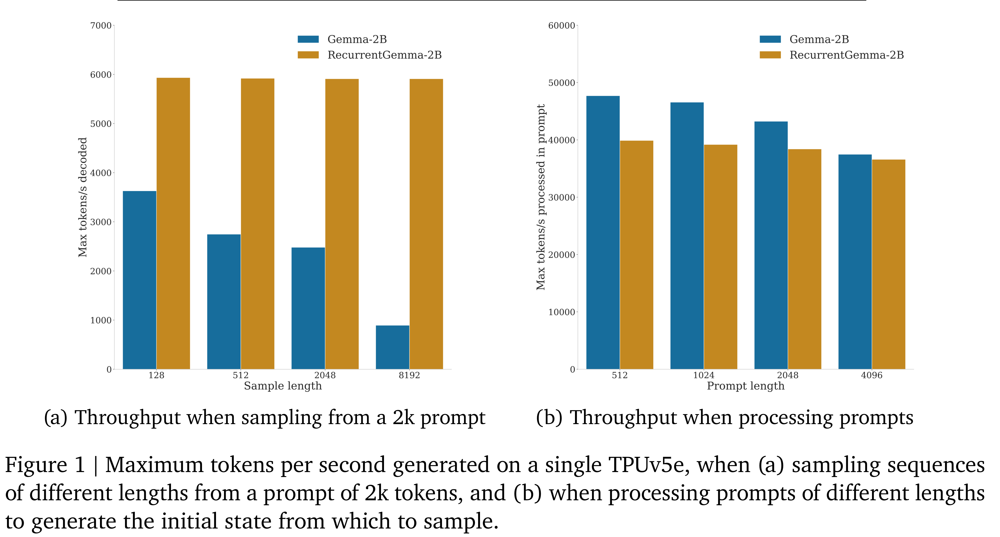

# RecurrentGemma: Moving Past Transformers for Efficient Open Language Models

[Official source](https://deepmind.google/models/gemma/recurrentgemma/)

We introduce RecurrentGemma, an open language model which uses Google’s novel Griffin architecture. Griffin combines linear recurrences with local attention to achieve excellent performance on language. It has a fixed-sized state, which reduces memory use and enables efficient inference on long sequences. We provide a pre-trained model with 2B non-embedding parameters, and an instruction tuned variant. Both models achieve comparable performance to Gemma-2B despite being trained on fewer tokens.

Figure 1 | Maximum tokens per second generated on a single TPUv5e, when (a) sampling sequences of different lengths from a prompt of 2k tokens, and (b) when processing prompts of different lengths to generate the initial state from which to sample.

p. 4
