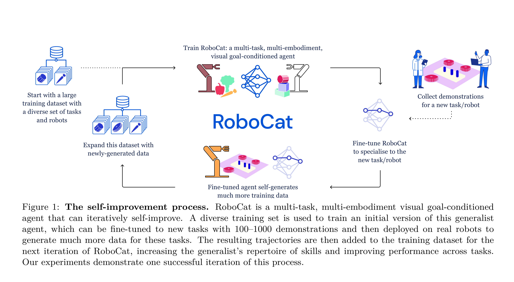
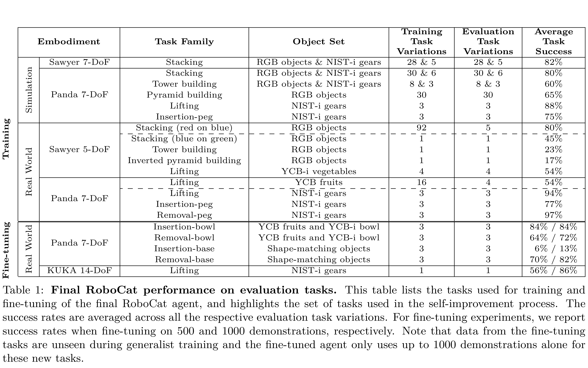

# RoboCat: A Self-Improving Generalist Agent for Robotic Manipulation

[Official source](https://arxiv.org/abs/2306.11706)

## Abstract

The ability to leverage heterogeneous robotic experience from different robots and tasks

to quickly master novel skills and embodiments has the potential to transform robot learn-

ing. Inspired by recent advances in foundation models for vision and language, we propose a

multi-embodiment, multi-task generalist agent for robotic manipulation. This agent, named

RoboCat, is a visual goal-conditioned decision transformer capable of consuming action-

labelled visual experience. This data spans a large repertoire of motor control skills from

simulated and real robotic arms with varying sets of observations and actions. With Robo-

Cat, we demonstrate the ability to generalise to new tasks and robots, both zero-shot as well

as through adaptation using only 100–1000 examples for the target task. We also show how

a trained model itself can be used to generate data for subsequent training iterations, thus

providing a basic building block for an autonomous improvement loop. We investigate the

agent’s capabilities, with large-scale evaluations both in simulation and on three different

real robot embodiments. We find that as we grow and diversify its training data, RoboCat

not only shows signs of cross-task transfer, but also becomes more efficient at adapting to

new tasks.

Figure 1: The self-improvement process. RoboCat is a multi-task, multi-embodiment visual goal-conditioned agent that can iteratively self-improve. A diverse training set is used to train an initial version of this generalist agent, which can be fine-tuned to new tasks with 100–1000 demonstrations and then deployed on real robots to generate much more data for these tasks. The resulting trajectories are then added to the training dataset for the next iteration of RoboCat, increasing the generalist’s repertoire of skills and improving performance across tasks. Our experiments demonstrate one successful iteration of this process.

p. 3

Table 1: Final RoboCat performance on evaluation tasks. This table lists the tasks used for training and fine-tuning of the final RoboCat agent, and highlights the set of tasks used in the self-improvement process. The success rates are averaged across all the respective evaluation task variations. For fine-tuning experiments, we report success rates when fine-tuning on 500 and 1000 demonstrations, respectively. Note that data from the fine-tuning tasks are unseen during generalist training and the fine-tuned agent only uses up to 1000 demonstrations alone for these new tasks.

p. 10
