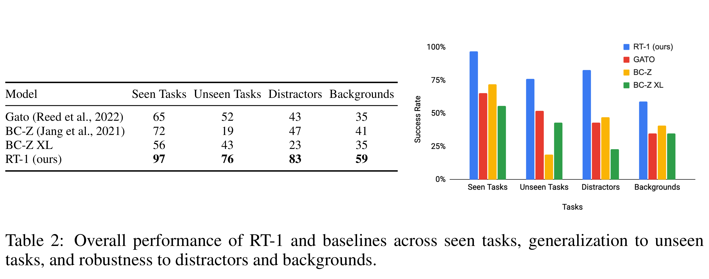
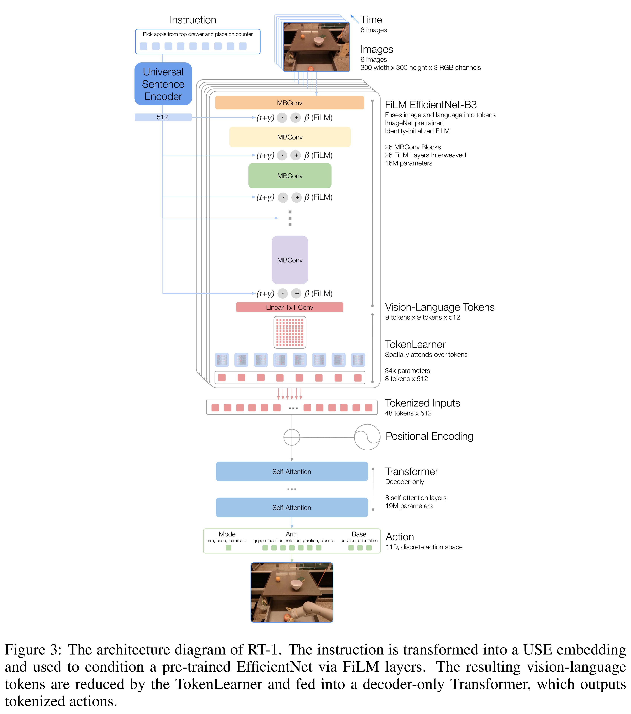

# RT-1: Robotics Transformer for Real-World Control at Scale

[Official source](https://arxiv.org/abs/2212.06817)

## ABSTRACT

By transferring knowledge from large, diverse, task-agnostic datasets, modern ma- chine learning models can solve specific downstream tasks either zero-shot or with small task-specific datasets to a high level of performance. While this capability has been demonstrated in other fields such as computer vision, natural language processing or speech recognition, it remains to be shown in robotics, where the generalization capabilities of the models are particularly critical due to the dif- ficulty of collecting real-world robotic data. We argue that one of the keys to the success of such general robotic models lies with open-ended task-agnostic training, combined with high-capacity architectures that can absorb all of the di- verse, robotic data. In this paper, we present a model class, dubbed Robotics Transformer, that exhibits promising scalable model properties. We verify our conclusions in a study of different model classes and their ability to generalize as a function of the data size, model size, and data diversity based on a large-scale data collection on real robots performing real-world tasks. The project’s website and videos can be found at robotics-transformer1.github.io

Table 2: Overall performance of RT-1 and baselines across seen tasks, generalization to unseen tasks, and robustness to distractors and backgrounds.

p. 10

Figure 3: The architecture diagram of RT-1. The instruction is transformed into a USE embedding and used to condition a pre-trained EfficientNet via FiLM layers. The resulting vision-language tokens are reduced by the TokenLearner and fed into a decoder-only Transformer, which outputs tokenized actions.

p. 6
