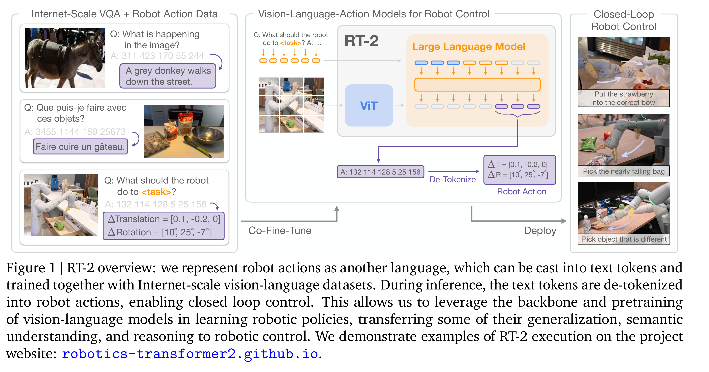

# RT-2: Vision-Language-Action Models Transfer Web Knowledge to Robotic Control

[Official source](https://arxiv.org/abs/2307.15818)

## 1. Introduction

High-capacity models pretrained on broad web-scale datasets provide an effective and powerful platform for a wide range of downstream tasks: large language models can enable not only fluent text generation (Anil et al., 2023; Brohan et al., 2022; OpenAI, 2023) but emergent problem-solving (Cobbe et al., 2021; Lewkowycz et al., 2022; Polu et al., 2022) and creative generation of prose (Brown et al., 2020; OpenAI, 2023) and code (Chen et al., 2021), while vision-language models enable open-vocabulary visual recognition (Kirillov et al., 2023; Minderer et al., 2022; Radford et al., 2021) and can even make complex inferences about object-agent interactions in images (Alayrac et al., 2022; Chen et al., 2023a,b; Driess et al., 2023; Hao et al., 2022; Huang et al., 2023; Wang et al., 2022). Such semantic reasoning, problem solving, and visual interpretation capabilities would be tremendously useful for generalist robots that must perform a variety of tasks in real-world environments. However, it is unclear how robots should acquire such capabilities. While a brute force approach might entail collecting millions of robotic interaction trials, the most capable language and vision-language models are trained on billions of tokens and images from the web (Alayrac et al., 2022; Chen et al., 2023a,b; Huang et al., 2023) – an amount unlikely to be matched with robot data in the near future. On the other hand, directly applying such models to robotic tasks is also difficult: such models reason about semantics, labels, and textual prompts, whereas robots require grounded low-level actions, such as Cartesian end-effector commands. While a number of recent works have sought to incorporate language models (LLMs) and vision-language models (VLMs) into robotics (Ahn et al., 2022; Driess et al., 2023; Vemprala et al., 2023), such methods generally address only the “higher level” aspects of robotic planning, essentially taking the role of a state machine that interprets commands and parses them into individual primitives (such as picking and placing objects), which are then executed by separate low-level controllers that themselves do not benefit from the rich semantic knowledge of Internet-scale models during training. Therefore, in this paper we ask: can large pretrained vision- language models be integrated directly into low-level robotic control to boost generalization and enable emergent semantic reasoning?

To this end, we explore an approach that is both simple and surprisingly effective: we directly train vision-language models designed for open-vocabulary visual question answering and visual dialogue to output low-level robot actions, along with solving other Internet-scale vision-language tasks. Although such models are typically trained to produce natural language tokens, we can train them on robotic trajectories by tokenizing the actions into text tokens and creating “multimodal sentences” (Driess et al., 2023) that “respond” to robotic instructions paired with camera observations by producing corresponding actions. In this way, vision-language models can be directly trained to act as instruction following robotic policies. This simple approach is in contrast with prior alternatives for incorporating VLMs into robot policies (Shridhar et al., 2022a) or designing new vision-language- action architectures from scratch (Reed et al., 2022): instead, pre-existing vision-language models, with already-amortized significant compute investment, are trained without any new parameters to output text-encoded actions. We refer to this category of models as vision-language-action (VLA) models. We instantiate VLA models by building on the protocol proposed for RT-1 (Brohan et al., 2022), using a similar dataset, but expanding the model to use a large vision-language backbone. Hence we refer to our model as RT-2 (Robotics Transformer 2). We provide an overview in Figure 1.

We observe that robotic policies derived from such vision-language models exhibit a range of remarkable capabilities, combining the physical motions learned from the robot data with the ability to interpret images and text learned from web data into a single model. Besides the expected benefit of dramatically improving generalization to novel objects and semantically varied instructions, we observe a number of emergent capabilities. While the model’s physical skills are still limited to the distribution of skills seen in the robot data, the model acquires the ability to deploy those skills in new ways by interpreting images and language commands using knowledge gleaned from the web. Some example highlights are shown in Figure 2. The model is able to re-purpose pick and place skills learned from robot data to place objects near semantically indicated locations, such as specific numbers or icons, despite those cues not being present in the robot data. The model can also interpret relations between objects to determine which object to pick and where to place it, despite no such relations being provided in the robot demonstrations. Furthermore, if we augment the command with chain of thought prompting, the model is able to make even more complex semantic inferences, such as figuring out which object to pick up for use as an improvised hammer (a rock), or which type of drink is best suited for someone who is tired (an energy drink).

Our main contribution is RT-2, a family of models derived from fine-tuning large vision-language models trained on web-scale data to directly act as generalizable and semantically aware robotic policies. Our experiments investigate models with up to 55B parameters trained on Internet data and instruction-annotated robotic trajectories from previous work (Brohan et al., 2022). Over the course of 6k robotic evaluations, we show that RT-2 enable significant improvements to generalization over objects, scenes, and instructions, and exhibit a breadth of emergent capabilities inherited from web-scale vision-language pretraining.

Figure 1 | RT-2 overview: we represent robot actions as another language, which can be cast into text tokens and trained together with Internet-scale vision-language datasets. During inference, the text tokens are de-tokenized into robot actions, enabling closed loop control. This allows us to leverage the backbone and pretraining of vision-language models in learning robotic policies, transferring some of their generalization, semantic understanding, and reasoning to robotic control. We demonstrate examples of RT-2 execution on the project website: robotics-transformer2.github.io.

p. 2
