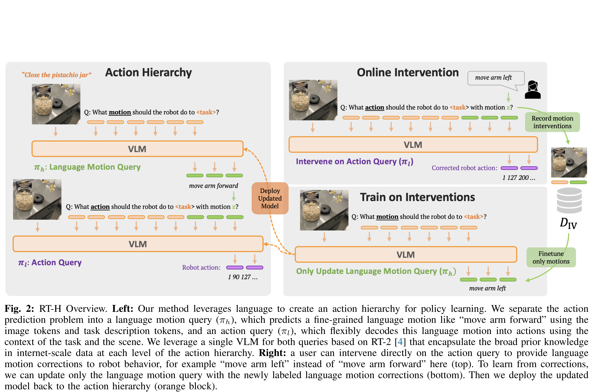
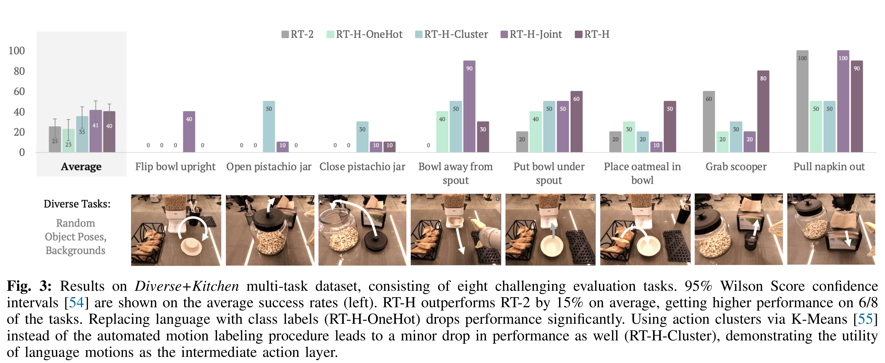

# RT-H: Action Hierarchies Using Language

[Official source](https://arxiv.org/abs/2403.01823)

## Abstract—

Language provides a way to break down complex concepts into digestible pieces. Recent works in robot imitation learning have proposed learning language-conditioned policies that predict actions given visual observations and the high-level task specified in language. These methods leverage the structure of natural language to share data between semantically similar tasks (e.g., “pick coke can” and “pick an apple”) in multi-task datasets. However, as tasks become more semantically diverse (e.g., “pick coke can” and “pour cup”), sharing data between tasks becomes harder and thus learning to map high-level tasks to actions requires substantially more demonstration data. To bridge this divide between tasks and actions, our insight is to teach the robot the language of actions, describing low- level motions with more fine-grained phrases like “move arm forward” or “close gripper”. Predicting these language motions as an intermediate step between high-level tasks and actions forces the policy to learn the shared structure of low-level motions across seemingly disparate tasks. Furthermore, a policy that is conditioned on language motions can easily be corrected during execution through human-specified language motions.

This enables a new paradigm for flexible policies that can learn from human intervention in language. Our method RT-H builds an action hierarchy using language motions: it first learns to predict language motions, and conditioned on this along with the high-level task, it then predicts actions, using visual context at all stages. Experimentally we show that RT-H leverages this language-action hierarchy to learn policies that are more robust and flexible by effectively tapping into multi-task datasets. We show that these policies not only allow for responding to language interventions, but can also learn from such interventions and outperform methods that learn from teleoperated interventions. Our website and videos are found at rt-hierarchy.github.io.

Fig. 2: RT-H Overview. Left: Our method leverages language to create an action hierarchy for policy learning. We separate the action prediction problem into a language motion query (πh), which predicts a fine-grained language motion like “move arm forward” using the image tokens and task description tokens, and an action query (πl), which flexibly decodes this language motion into actions using the context of the task and the scene. We leverage a single VLM for both queries based on RT-2 [4] that encapsulate the broad prior knowledge in internet-scale data at each level of the action hierarchy. Right: a user can intervene directly on the action query to provide language motion corrections to robot behavior, for example “move arm left” instead of “move arm forward” here (top). To learn from corrections, we can update only the language motion query with the newly labeled language motion corrections (bottom). Then we deploy the updated model back to the action hierarchy (orange block).

p. 4

Fig. 3: Results on Diverse+Kitchen multi-task dataset, consisting of eight challenging evaluation tasks. 95% Wilson Score confidence intervals [54] are shown on the average success rates (left). RT-H outperforms RT-2 by 15% on average, getting higher performance on 6/8 of the tasks. Replacing language with class labels (RT-H-OneHot) drops performance significantly. Using action clusters via K-Means [55] instead of the automated motion labeling procedure leads to a minor drop in performance as well (RT-H-Cluster), demonstrating the utility of language motions as the intermediate action layer.

p. 6
