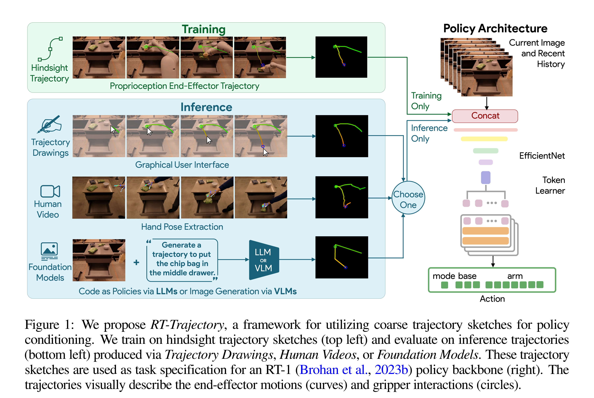
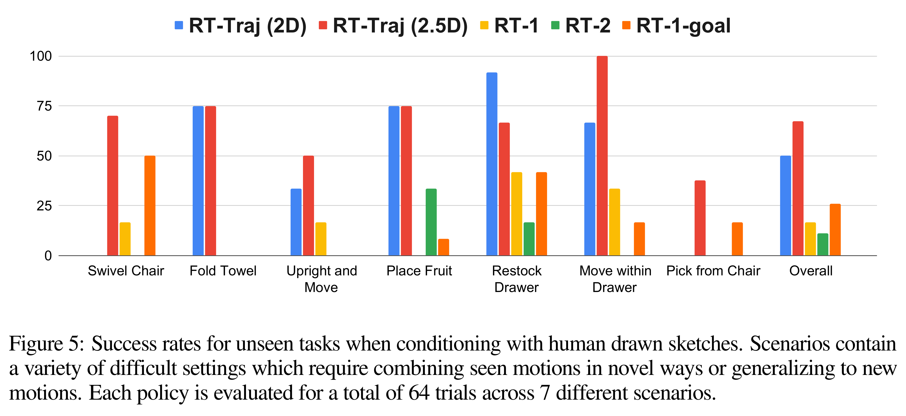

# Robotic Task Generalization via Hindsight Trajectory Sketches

[Official source](https://arxiv.org/abs/2311.01977)

## ABSTRACT

Generalization remains one of the most important desiderata for robust robot learning systems. While recently proposed approaches show promise in generalization to novel objects, semantic concepts, or visual distribution shifts, generalization to new tasks remains challenging. For example, a language-conditioned policy trained on pick-and- place tasks will not be able to generalize to a folding task, even if the arm trajectory of folding is similar to pick-and-place. Our key insight is that this kind of generalization becomes feasible if we represent the task through rough trajectory sketches. We propose a policy conditioning method using such rough trajectory sketches, which we call RT- Trajectory, that is practical, easy to specify, and allows the policy to effectively perform new tasks that would otherwise be challenging to perform. We find that trajectory sketches strike a balance between being detailed enough to express low-level motion- centric guidance while being coarse enough to allow the learned policy to interpret the trajectory sketch in the context of situational visual observations. In addition, we show how trajectory sketches can provide a useful interface to communicate with robotic policies – they can be specified through simple human inputs like drawings or videos, or through automated methods such as modern image-generating or waypoint-generating methods. We evaluate RT-Trajectory at scale on a variety of real-world robotic tasks, and find that RT-Trajectory is able to perform a wider range of tasks compared to language- conditioned and goal-conditioned policies, when provided the same training data. Eval- uation videos can be found at https://rt-trajectory.github.io/.

Figure 1: We propose RT-Trajectory, a framework for utilizing coarse trajectory sketches for policy conditioning. We train on hindsight trajectory sketches (top left) and evaluate on inference trajectories (bottom left) produced via Trajectory Drawings, Human Videos, or Foundation Models. These trajectory sketches are used as task specification for an RT-1 (Brohan et al., 2023b) policy backbone (right). The trajectories visually describe the end-effector motions (curves) and gripper interactions (circles).

p. 2

Figure 5: Success rates for unseen tasks when conditioning with human drawn sketches. Scenarios contain a variety of difficult settings which require combining seen motions in novel ways or generalizing to new motions. Each policy is evaluated for a total of 64 trials across 7 different scenarios.

p. 7
