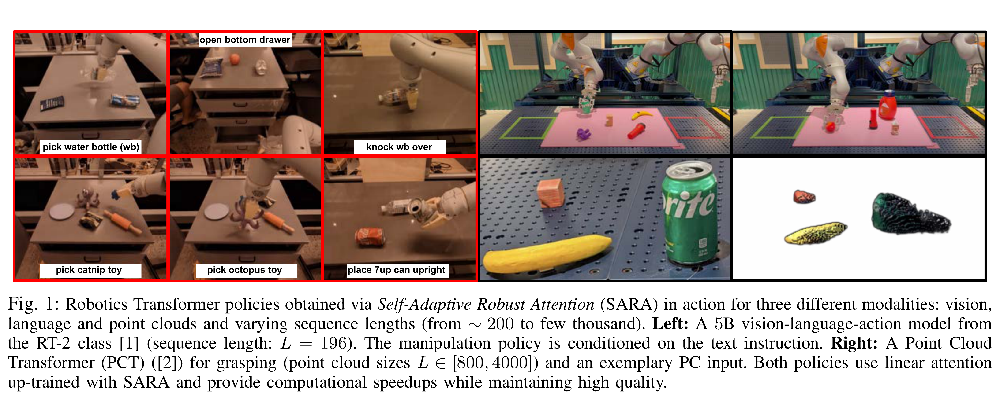
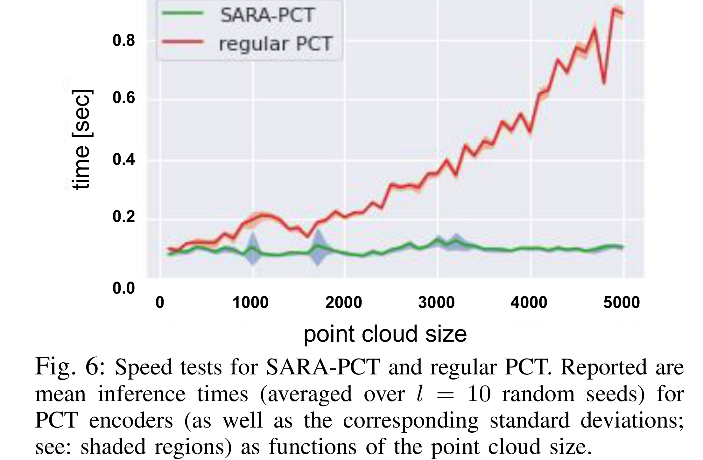

# SARA-RT: Scaling up Robotics Transformers with Self-Adaptive Robust Attention

[Official source](https://arxiv.org/abs/2312.01990)

## Abstract—

We present Self-Adaptive Robust Attention for Robotics Transformers (SARA-RT): a new paradigm for addressing the emerging challenge of scaling up Robotics Transformers (RT) for on-robot deployment. SARA-RT relies on the new method of fine-tuning proposed by us, called up-training. It converts pre-trained or already fine-tuned Transformer-based robotic policies of quadratic time complexity (including massive billion-parameter vision-language-action models or VLAs), into their efficient linear-attention counterparts maintaining high quality. We demonstrate the effectiveness of SARA-RT by speeding up: (a) the class of recently introduced RT-2 models [1], the first VLA robotic policies pre-trained on internet-scale data, as well as (b) Point Cloud Transformer (PCT) robotic policies operating on large point clouds. We complement our results with the rigorous mathematical analysis providing deeper insight into the phenomenon of SARA.

Fig. 1: Robotics Transformer policies obtained via Self-Adaptive Robust Attention (SARA) in action for three different modalities: vision, language and point clouds and varying sequence lengths (from ∼200 to few thousand). Left: A 5B vision-language-action model from the RT-2 class [1] (sequence length: L = 196). The manipulation policy is conditioned on the text instruction. Right: A Point Cloud Transformer (PCT) ([2]) for grasping (point cloud sizes L ∈[800, 4000]) and an exemplary PC input. Both policies use linear attention up-trained with SARA and provide computational speedups while maintaining high quality.

p. 1

Fig. 6: Speed tests for SARA-PCT and regular PCT. Reported are mean inference times (averaged over l = 10 random seeds) for PCT encoders (as well as the corresponding standard deviations; see: shaded regions) as functions of the point cloud size.

p. 5
