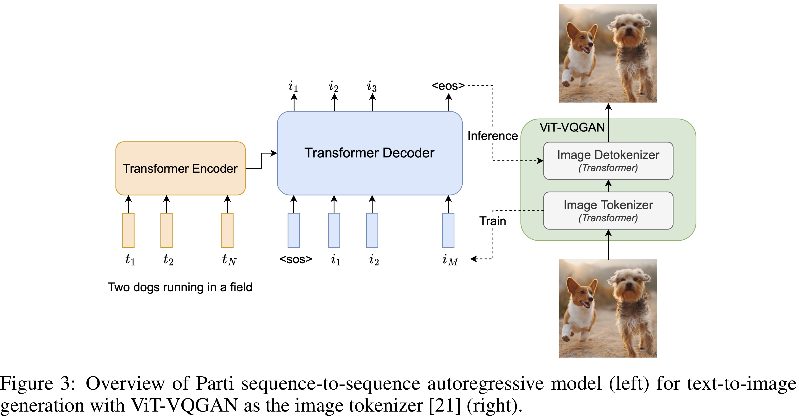

# Scaling Autoregressive Models for Content-Rich Text-to-Image Generation

[Official source](https://arxiv.org/abs/2206.10789)

## Abstract

We present the Pathways [1] Autoregressive Text-to-Image (Parti) model, which generates high-fidelity photorealistic images and supports content-rich synthesis involving complex compositions and world knowledge. Parti treats text-to-image generation as a sequence-to-sequence modeling problem, akin to machine translation, with sequences of image tokens as the target outputs rather than text tokens in another language. This strategy can naturally tap into the rich body of prior work on large language models, which have seen continued advances in capabilities and performance through scaling data and model sizes. Our approach is simple: First, Parti uses a Transformer-based image tokenizer, ViT-VQGAN, to encode images as sequences of discrete tokens. Second, we achieve consistent quality improvements by scaling the encoder-decoder Transformer model up to 20B parameters, with a new state-of-the-art zero-shot FID score of 7.23 and finetuned FID score of 3.22 on MS-COCO. Our detailed analysis on Localized Narratives as well as PartiPrompts (P2), a new holistic benchmark of over 1600 English prompts, demonstrate the effectiveness of Parti across a wide variety of categories and difficulty aspects. We also explore and highlight limitations of our models in order to define and exemplify key areas of focus for further improvements. See parti.research.google for high-resolution images.

Figure 3: Overview of Parti sequence-to-sequence autoregressive model (left) for text-to-image generation with ViT-VQGAN as the image tokenizer [21] (right).

p. 4
