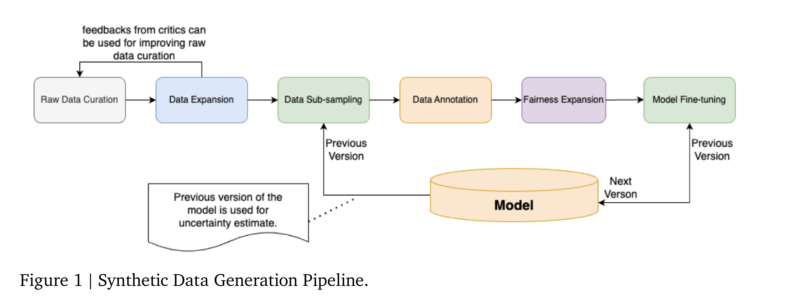

# ShieldGemma 1 Technical Report

[Official source](https://ai.google.dev/gemma/docs/shieldgemma/model_card)

We present ShieldGemma, a comprehensive suite of LLM-based safety content moderation models built upon Gemma2. These models provide robust, state-of-the-art predictions of safety risks across key harm types (sexually explicit, dangerous content, harassment, hate speech) in both user input and LLM-generated output. By evaluating on both public and internal benchmarks, we demonstrate superior performance compared to existing models, such as Llama Guard (+10.8% AU-PRC on public benchmarks) and WildCard (+4.3%). Additionally, we present a novel LLM-based data curation pipeline, adaptable to a variety of safety-related tasks and beyond. We have shown strong generalization performance for model trained mainly on synthetic data. By releasing ShieldGemma, we provide a valuable resource to the research community, advancing LLM safety and enabling the creation of more effective content moderation solutions for developers.

https://huggingface.co/google/shieldgemma-2b(/9b/27b) https://www.kaggle.com/models/google/shieldgemma http://ai.google.dev/gemma/docs/shieldgemma/model_card

Figure 1 | Synthetic Data Generation Pipeline.

p. 4
