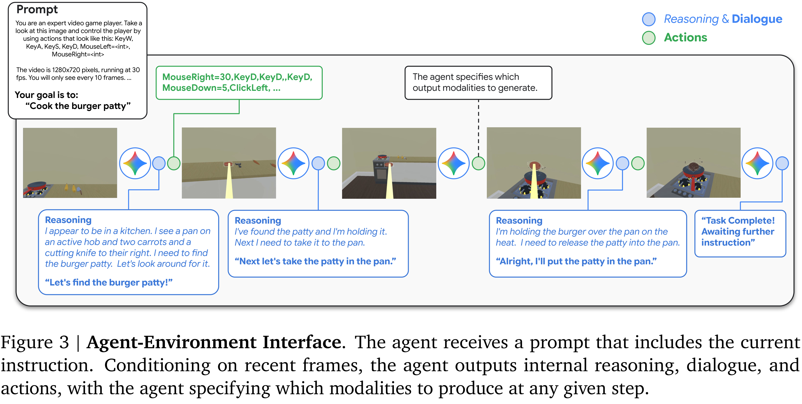
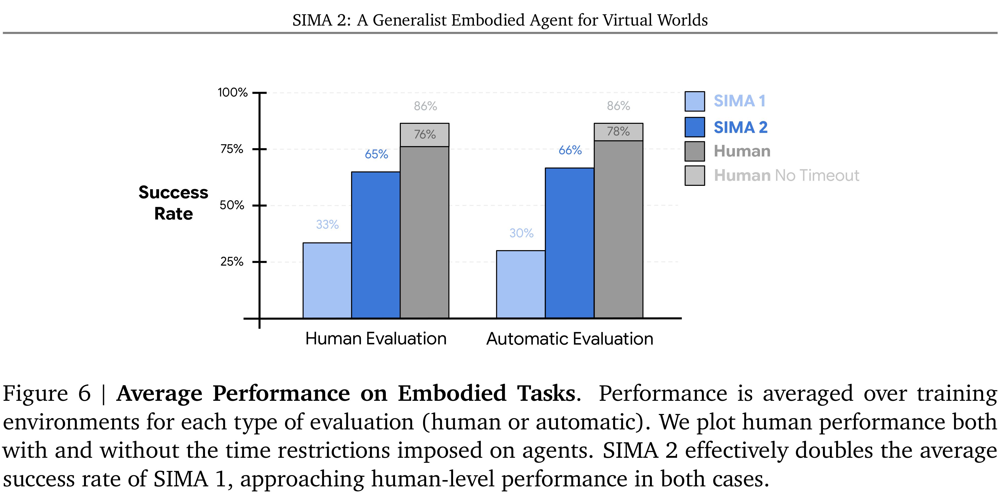
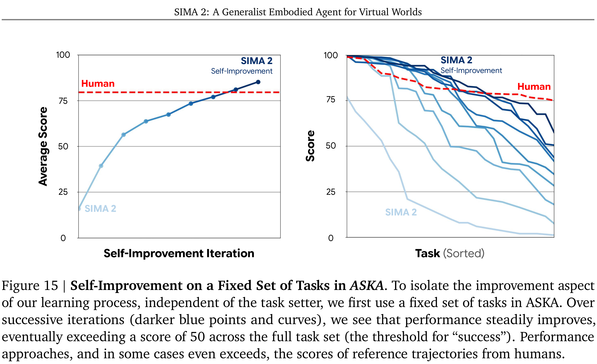

# SIMA 2: A Generalist Embodied Agent for Virtual Worlds

[Official source](https://arxiv.org/abs/2512.04797)

We introduce SIMA 2, a generalist embodied agent that understands and acts in a wide variety of 3D virtual worlds. Built upon a Gemini foundation model, SIMA 2 represents a significant step toward active, goal-directed interaction within an embodied environment. Unlike prior work (e.g., SIMA 1) limited to simple language commands, SIMA 2 acts as an interactive partner, capable of reasoning about high-level goals, conversing with the user, and handling complex instructions given through language and images. Across a diverse portfolio of games, SIMA 2 substantially closes the gap with human performance and demonstrates robust generalization to previously unseen environments, all while retaining the base model’s core reasoning capabilities. Furthermore, we demonstrate a capacity for open-ended self-improvement: by leveraging Gemini to generate tasks and provide rewards, SIMA 2 can autonomously learn new skills from scratch in a new environment. This work validates a path toward creating versatile and continuously learning agents for both virtual and, eventually, physical worlds.

Figure   3   |   Agent-Environment   Interface .   The   agent   receives   a   prompt   that   includes   the   current instruction.   Conditioning   on   recent   frames,   the   agent   outputs   internal   reasoning,   dialogue,   and actions, with the agent specifying which modalities to produce at any given step.

p. 7

Figure   6   |   Average   Performance   on   Embodied   Tasks .   Performance   is   averaged   over   training environments for each type of evaluation (human or automatic).   We plot human performance both with and without the time restrictions imposed on agents.   SIMA 2 effectively doubles the average success rate of SIMA 1, approaching human-level performance in both cases.

p. 14

Figure 15   |   Self-Improvement on a Fixed Set of Tasks in  ASKA . To isolate the improvement aspect of our learning process, independent of the task setter, we first use a fixed set of tasks in ASKA. Over successive   iterations   (darker   blue   points   and   curves),   we   see   that   performance   steadily   improves, eventually exceeding a score of 50 across the full task set (the threshold for “success”).   Performance approaches, and in some cases even exceeds, the scores of reference trajectories from humans.

p. 24
