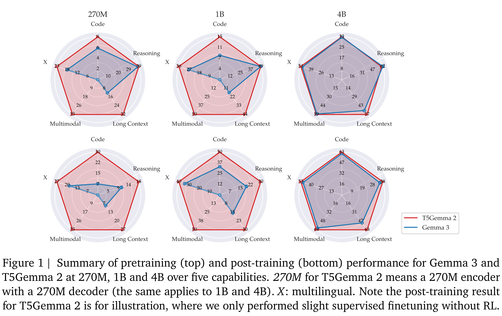
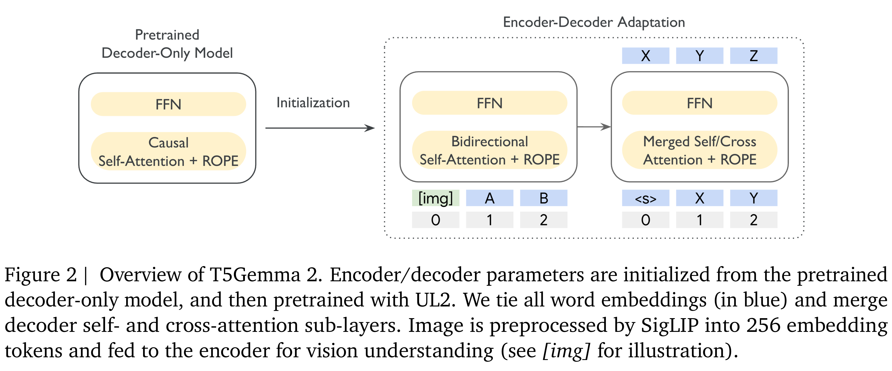

# T5Gemma 2: Seeing, Reading, and Understanding Longer

[Official source](https://deepmind.google/models/gemma/t5gemma/)

We introduce T5Gemma 2, the next generation of the T5Gemma family of lightweight open encoder- decoder models, featuring strong multilingual, multimodal and long-context capabilities. T5Gemma 2 follows the adaptation recipe (via UL2) in T5Gemma – adapting a pretrained decoder-only model into an encoder-decoder model, and extends it from text-only regime to multimodal based on the Gemma 3 models. We further propose two methods to improve the efficiency: tied word embedding that shares all embeddings across encoder and decoder, and merged attention that unifies decoder self- and cross- attention into a single joint module. Experiments demonstrate the generality of the adaptation strategy over architectures and modalities as well as the unique strength of the encoder-decoder architecture on long context modeling. Similar to T5Gemma, T5Gemma 2 yields comparable or better pretraining performance and significantly improved post-training performance than its Gemma 3 counterpart. We release the pretrained models (270M-270M, 1B-1B and 4B-4B) to the community for future research.

Figure 1 | Summary of pretraining (top) and post-training (bottom) performance for Gemma 3 and
T5Gemma 2 at 270M, 1B and 4B over five capabilities. 270M for T5Gemma 2 means a 270M encoder
with a 270M decoder (the same applies to 1B and 4B). X: multilingual. Note the post-training result
for T5Gemma 2 is for illustration, where we only performed slight supervised finetuning without RL.

p. 1

Figure 2 | Overview of T5Gemma 2. Encoder/decoder parameters are initialized from the pretrained
decoder-only model, and then pretrained with UL2. We tie all word embeddings (in blue) and merge
decoder self- and cross-attention sub-layers. Image is preprocessed by SigLIP into 256 embedding
tokens and fed to the encoder for vision understanding (see [img] for illustration).

p. 2
