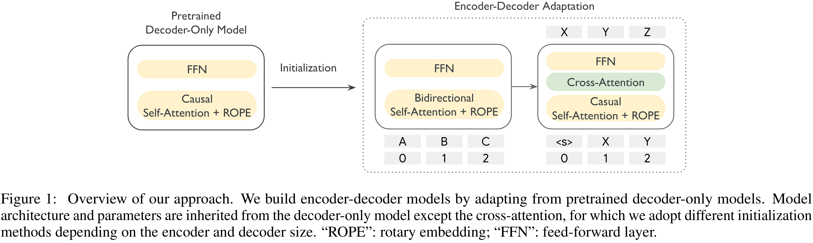

# Encoder-Decoder Gemma: Improving the Quality-Efficiency Trade-Off via Adaptation

[Official source](https://arxiv.org/abs/2504.06225)

## Abstract

While decoder-only large language models (LLMs) have shown impressive results, encoder-decoder models are still widely adopted in real-world applications for their inference efficiency and richer encoder representation. In this paper, we study a novel problem: adapting pre-trained decoder-only LLMs to encoder-decoder, with the goal of leveraging the strengths of both approaches to achieve a more favorable quality-efficiency trade-off. We argue that adaptation not only enables inheriting the capability of decoder-only LLMs but also reduces the demand for computation compared to pretraining from scratch. We rigorously explore different pretraining objectives and parameter initialization/optimization techniques. Through extensive experiments based on Gemma 2 (2B and 9B) and a suite of newly pretrained mT5-sized models (up to 1.6B), we demonstrate the effectiveness of adaptation and the advantage of encoder-decoder LLMs. Under similar inference budget, encoder-decoder LLMs achieve comparable (often better) pretraining performance but substantially better finetuning performance than their decoder-only counterpart. For example, Gemma 2B-2B outperforms Gemma 2B by ∼7% after instruction tuning. Encoder-decoder adaptation also allows for flexible combination of different-sized models, where Gemma 9B-2B significantly surpasses Gemma 2B-2B by >3%. The adapted encoder representation also yields better results on SuperGLUE. We will release our checkpoints to facilitate future research.

Figure 1: Overview of our approach. We build encoder-decoder models by adapting from pretrained decoder-only models. Model architecture and parameters are inherited from the decoder-only model except the cross-attention, for which we adopt different initialization methods depending on the encoder and decoder size. “ROPE”: rotary embedding; “FFN”: feed-forward layer.

p. 2
