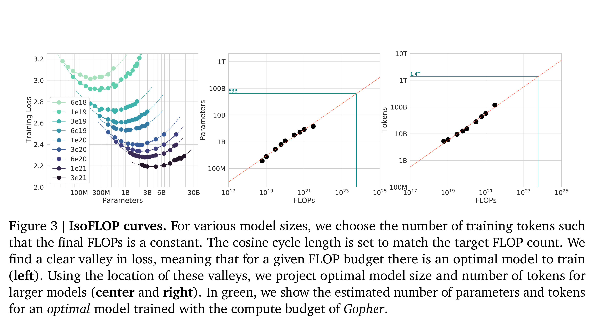

# Training Compute-Optimal Large Language Models

[Official source](https://arxiv.org/abs/2203.15556)

## 1. Introduction

Recently a series of Large Language Models (LLMs) have been introduced (Brown et al., 2020; Lieber et al., 2021; Rae et al., 2021; Smith et al., 2022; Thoppilan et al., 2022), with the largest dense language models now having over 500 billion parameters. These large autoregressive transformers (Vaswani et al., 2017) have demonstrated impressive performance on many tasks using a variety of evaluation protocols such as zero-shot, few-shot, and fine-tuning.

The compute and energy cost for training large language models is substantial (Rae et al., 2021; Thoppilan et al., 2022) and rises with increasing model size. In practice, the allocated training compute budget is often known in advance: how many accelerators are available and for how long we want to use them. Since it is typically only feasible to train these large models once, accurately estimating the best model hyperparameters for a given compute budget is critical (Tay et al., 2021).

Kaplan et al. (2020) showed that there is a power law relationship between the number of parameters in an autoregressive language model (LM) and its performance. As a result, the field has been training larger and larger models, expecting performance improvements. One notable conclusion in Kaplan et al. (2020) is that large models should not be trained to their lowest possible loss to be compute optimal. Whilst we reach the same conclusion, we estimate that large models should be trained for many more training tokens than recommended by the authors. Specifically, given a 10× increase computational budget, they suggests that the size of the model should increase 5.5× while the number of training tokens should only increase 1.8×. Instead, we find that model size and the number of training tokens should be scaled in equal proportions.

Following Kaplan et al. (2020) and the training setup of GPT-3 (Brown et al., 2020), many of the recently trained large models have been trained for approximately 300 billion tokens (Table 1), in line with the approach of predominantly increasing model size when increasing compute.

In this work, we revisit the question: Given a fixed FLOPs budget,1 how should one trade-off model size and the number of training tokens? To answer this question, we model the final pre-training loss2 𝐿(𝑁, 𝐷) as a function of the number of model parameters 𝑁, and the number of training tokens, 𝐷. Since the computational budget 𝐶 is a deterministic function FLOPs(𝑁, 𝐷) of the number of seen training tokens and model parameters, we are interested in minimizing 𝐿 under the constraint FLOPs(𝑁, 𝐷) = 𝐶:

𝐿(𝑁, 𝐷).

(1)

The functions 𝑁𝑜𝑝𝑡 (𝐶), and 𝐷𝑜𝑝𝑡 (𝐶) describe the optimal allocation of a computational budget 𝐶. We empirically estimate these functions based on the losses of over 400 models, ranging from under 70M to over 16B parameters, and trained on 5B to over 400B tokens – with each model configuration trained for several different training horizons. Our approach leads to considerably different results than that of Kaplan et al. (2020). We highlight our results in Figure 1 and how our approaches differ in Section 2.

Based on our estimated compute-optimal frontier, we predict that for the compute budget used to train Gopher, an optimal model should be 4 times smaller, while being training on 4 times more tokens. We verify this by training a more compute-optimal 70B model, called Chinchilla, on 1.4 trillion tokens. Not only does Chinchilla outperform its much larger counterpart, Gopher, but its reduced model size reduces inference cost considerably and greatly facilitates downstream uses on smaller hardware. The energy cost of a large language model is amortized through its usage for inference an fine-tuning. The benefits of a more optimally trained smaller model, therefore, extend beyond the immediate benefits of its improved performance.

Figure 3 | IsoFLOP curves. For various model sizes, we choose the number of training tokens such that the final FLOPs is a constant. The cosine cycle length is set to match the target FLOP count. We find a clear valley in loss, meaning that for a given FLOP budget there is an optimal model to train (left). Using the location of these valleys, we project optimal model size and number of tokens for larger models (center and right). In green, we show the estimated number of parameters and tokens for an optimal model trained with the compute budget of Gopher.

p. 6
