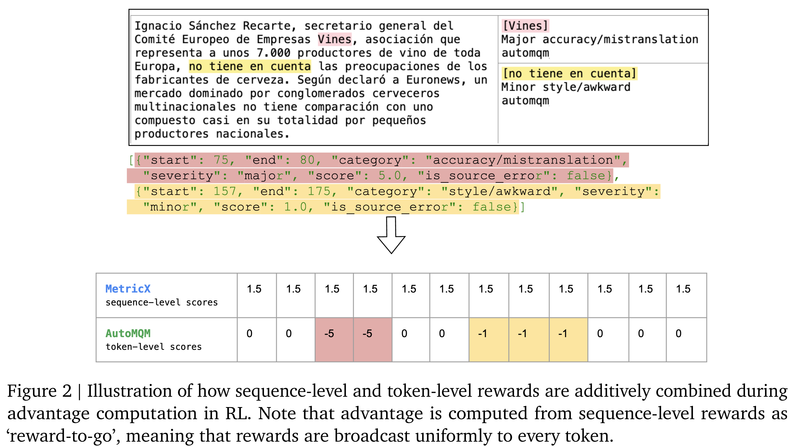

# TranslateGemma Technical Report

[PDF](../../pdfs/google/technical-reports/translategemma-technical-report--arxiv-v3.pdf#page=1) · [Official source](https://arxiv.org/abs/2601.09012)

We present TranslateGemma, a suite of open machine translation models based on the Gemma 3 foundation models. To enhance the inherent multilingual capabilities of Gemma 3 for the translation task, we employ a two-stage fine-tuning process. First, supervised fine-tuning is performed using a rich mixture of high-quality large-scale synthetic parallel data generated via state-of-the-art models and human-translated parallel data. This is followed by a reinforcement learning phase, where we optimize translation quality using an ensemble of reward models, including MetricX-QE and AutoMQM, targeting translation quality. We demonstrate the effectiveness of TranslateGemma with human evaluation on the WMT25 test set across 10 language pairs and with automatic evaluation on the WMT24++ benchmark across 55 language pairs. Automatic metrics show consistent and substantial gains over the baseline Gemma 3 models across all sizes. Notably, smaller TranslateGemma models often achieve performance comparable to larger baseline models, offering improved efficiency. We also show that TranslateGemma models retain strong multimodal capabilities, with enhanced performance on the Vistra image translation benchmark. The release of the open TranslateGemma models aims to provide the research community with powerful and adaptable tools for machine translation.

Figure 2 | Illustration of how sequence-level and token-level rewards are additively combined during
advantage computation in RL. Note that advantage is computed from sequence-level rewards as
‘reward-to-go’, meaning that rewards are broadcast uniformly to every token.

[p. 4](../../pdfs/google/technical-reports/translategemma-technical-report--arxiv-v3.pdf#page=4) · [PDF](../../figures/google/translategemma-technical-report/figure-01.pdf)
