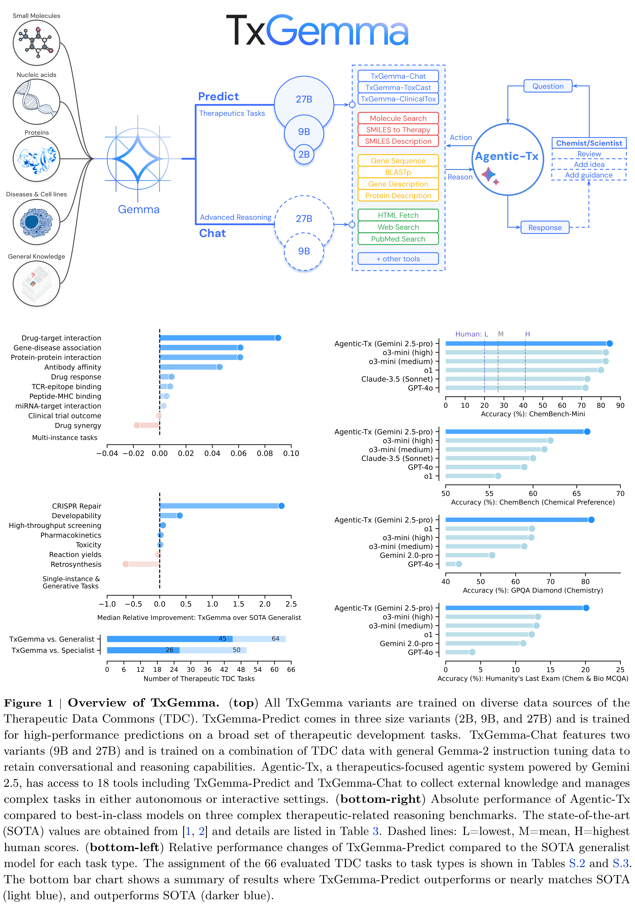
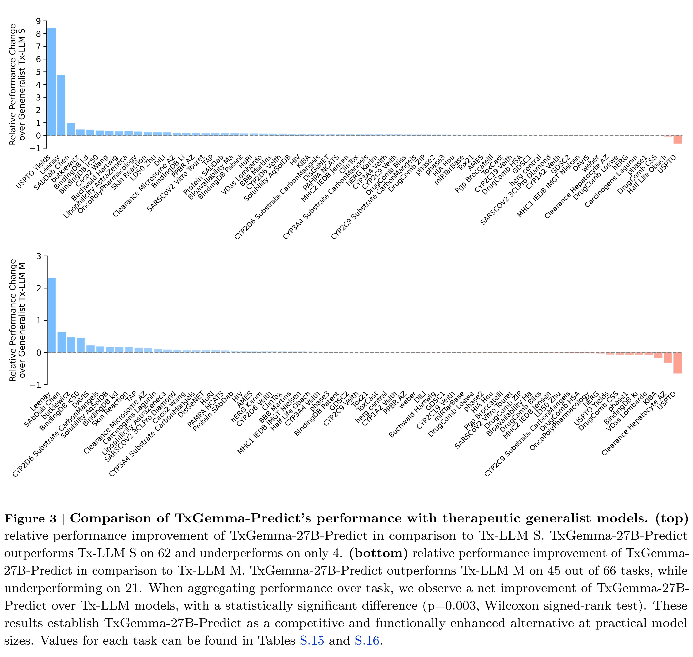

# TxGemma: Efficient and Agentic LLMs for Therapeutics

[Official source](https://deepmind.google/models/gemma/txgemma/)

## 1 Introduction

The pharmaceutical industry faces significant challenges in bringing new therapeutics to market. High attrition rates and lengthy, costly development timelines [3, 4] necessitate innovative approaches to therapeutic development. Success requires a drug candidate to not only demonstrate efficacy but also possess favorable safety, metabolic stability, pharmacokinetic/pharmacodynamic properties and developability, among other characteristics. Determining these diverse characteristics often relies on a large array of complex and expensive experimental procedures, highlighting the need for more efficient methods.

Computational approaches, such as machine learning, are emerging as powerful tools to address these challenges. Leveraging predictive models trained on curated datasets allows researchers to prioritize promising candidates early in the development process, reducing reliance on costly experimental assays [5]. Publicly available databases of molecular properties and biological activity are crucial for training and validating these models. In this area, a major development was the curation of the Therapeutics Data Commons (TDC) [6, 7, 8], which contains datasets and benchmarks for many different tasks throughout the therapeutic development pipeline, ranging from early-stage target identification to late-stage clinical trial approval.

Recent advancements in large language models (LLMs) offer a compelling opportunity to leverage available datasets and address limitations in the therapeutic development process. LLMs have demonstrated the capacity to integrate and learn from diverse data sources across various domains, including scientific applications [9, 10, 11]. Their potential to connect disparate aspects of drug development, such as chemical structure, biological activity, and clinical trial outcomes, is particularly exciting. In this context, we have previously introduced Tx-LLM, a LLM fine-tuned from a collection of question-answer instruction-tuning datasets based on TDC [12]. While promising, the model’s lack of conversational capabilities prevented reasoning or user interaction, limiting its value for scientists who require a model that can understand complex queries and engage in nuanced discussions.

In this work, we introduce TxGemma, a suite of efficient, generalist LLMs trained for therapeutics. Building on, but significantly extending, our previous work [12], TxGemma leverages LLMs to synthesize information from diverse sources. The suite includes 2B, 9B, and 27B parameter models, fine-tuned from Gemma-2 [13, 14] using a collection of therapeutic instruction-tuning datasets encompassing small molecules, proteins, nucleic acids, diseases, and cell lines. For the first time in therapeutic AI, TxGemma features conversational counterparts capable of reasoning and explanation, moving beyond black-box predictions to facilitate mechanistic understanding and scientific discussions. Our key contributions are as follows:

• Efficient Generalist Therapeutic LLMs: TxGemma represents a potential shift from task-specific AI to efficient generalist models in therapeutic development. These efficient LLMs (2B-27B parameters) offer a competitive alternative to specialized models, achieving strong performance across a broad range of predictive and generative tasks. Out of 66 therapeutic development tasks curated by TDC, TxGemma-Predict outperforms or nearly matches the state-of-the-art generalist model on 64 (outperforms on 45) and state-of-the-art specialist models on 50 (outperforms on 26). Additionally, fine-tuning TxGemma models on clinical trial adverse event prediction requires less data to achieve strong performance compared to base Gemma-2 models, an important advantage for data-limited fields.

• Explainable and Interactive Therapeutic Models: TxGemma-Chat introduces reasoning and explanation capabilities, bridging the gap between general LLMs and specialized property predictors. Scientists can interact with TxGemma-Chat using natural language, exploring complex questions, receive explanations for predictions (e.g., based on molecular structure), and engage in scientific discussions.

• Agentic Orchestration of Therapeutic Development Workflows: We further introduce Agentic-Tx, a therapeutics-focused agentic system powered by Gemini 2.5, demonstrating how TxGemma models can be integrated as tools. Equipped with 18 tools, Agentic-Tx solves complex, multi-step problems, achieving state-of-the-art results on reasoning-intensive chemistry and biology benchmarks, including Humanity’s Last Exam [15] and ChemBench [1].

• Enabling Innovative Research with Open Models: Understanding the prevalence of proprietary data in therapeutic research, we release TxGemma models trained only on datasets with commercial licenses as open models to empower researchers to adapt and refine them on their own data. This facilitates validation and potential performance improvements tailored to their specific research needs, paving the way for therapy safety and efficacy in more challenging real-world therapeutic applications.

Figure 1 | Overview of TxGemma. (top) All TxGemma variants are trained on diverse data sources of the Therapeutic Data Commons (TDC). TxGemma-Predict comes in three size variants (2B, 9B, and 27B) and is trained for high-performance predictions on a broad set of therapeutic development tasks. TxGemma-Chat features two variants (9B and 27B) and is trained on a combination of TDC data with general Gemma-2 instruction tuning data to retain conversational and reasoning capabilities. Agentic-Tx, a therapeutics-focused agentic system powered by Gemini 2.5, has access to 18 tools including TxGemma-Predict and TxGemma-Chat to collect external knowledge and manages complex tasks in either autonomous or interactive settings. (bottom-right) Absolute performance of Agentic-Tx compared to best-in-class models on three complex therapeutic-related reasoning benchmarks. The state-of-the-art (SOTA) values are obtained from [1, 2] and details are listed in Table 3. Dashed lines: L=lowest, M=mean, H=highest

p. 2

Figure 3 | Comparison of TxGemma-Predict’s performance with therapeutic generalist models. (top) relative performance improvement of TxGemma-27B-Predict in comparison to Tx-LLM S. TxGemma-27B-Predict outperforms Tx-LLM S on 62 and underperforms on only 4. (bottom) relative performance improvement of TxGemma- 27B-Predict in comparison to Tx-LLM M. TxGemma-27B-Predict outperforms Tx-LLM M on 45 out of 66 tasks, while underperforming on 21. When aggregating performance over task, we observe a net improvement of TxGemma-27B-Predict over Tx-LLM models, with a statistically significant difference (p=0.003, Wilcoxon signed-rank test). These results establish TxGemma-27B-Predict as a competitive and functionally enhanced alternative at practical model sizes. Values for each task can be found in Tables S.15 and S.16.

p. 7
