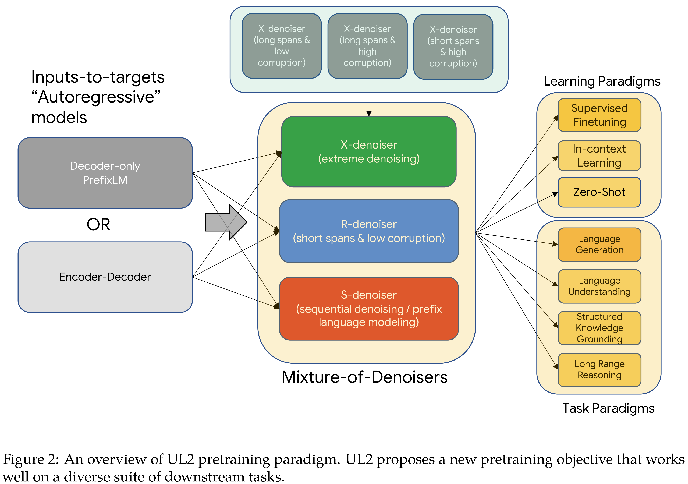

# UL2: Unifying Language Learning Paradigms

[Official source](https://arxiv.org/abs/2205.05131)

## Abstract

Existing pre-trained models are generally geared towards a particular class of problems. To date, there seems to be still no consensus on what the right architecture and pre-training setup should be. This paper presents a unified framework for pre-training models that are universally effective across datasets and setups. We begin by disentangling architectural archetypes with pre-training objectives – two concepts that are commonly conflated. Next, we present a generalized and unified perspective for self-supervision in NLP and show how different pre-training objectives can be cast as one another and how interpolating between different objectives can be effective. We then propose Mixture-of-Denoisers (MoD), a pre-training objective that combines diverse pre-training paradigms together. We furthermore introduce a notion of mode switching, wherein downstream fine-tuning is associated with specific pre-training schemes. We conduct extensive ablative experiments to compare multiple pre-training objectives and find that our method pushes the Pareto-frontier by outperforming T5 and/or GPT-like models across multiple diverse setups. Finally, by scaling our model up to 20B parameters, we achieve SOTA performance on 50 well-established supervised NLP tasks ranging from language generation (with automated and human evaluation), language understanding, text classification, question answering, commonsense reasoning, long text reasoning, structured knowledge grounding and information retrieval. Our model also achieve strong results at in-context learning, outperforming 175B GPT-3 (published paper results) on zero-shot SuperGLUE and tripling the performance of T5-XXL on one-shot summarization. On zero-shot MMLU, UL2 20B outperforms T0 and T5 models. Additionally, we show that UL2 20B works well with chain-of-thought prompting and reasoning, making it an appealing choice for research into reasoning at a small to medium scale of 20B parameters. Finally, we apply FLAN instruction tuning to the UL2 20B model, achieving MMLU and Big-Bench scores competitive to FLAN-PaLM 62B. We release Flax-based T5X model checkpoints for the UL2 20B model and Flan-UL2 20B model at https://github.com/google-research/google-research/tree/master/ul2.

Figure 2: An overview of UL2 pretraining paradigm. UL2 proposes a new pretraining objective that works well on a diverse suite of downstream tasks.

p. 8
