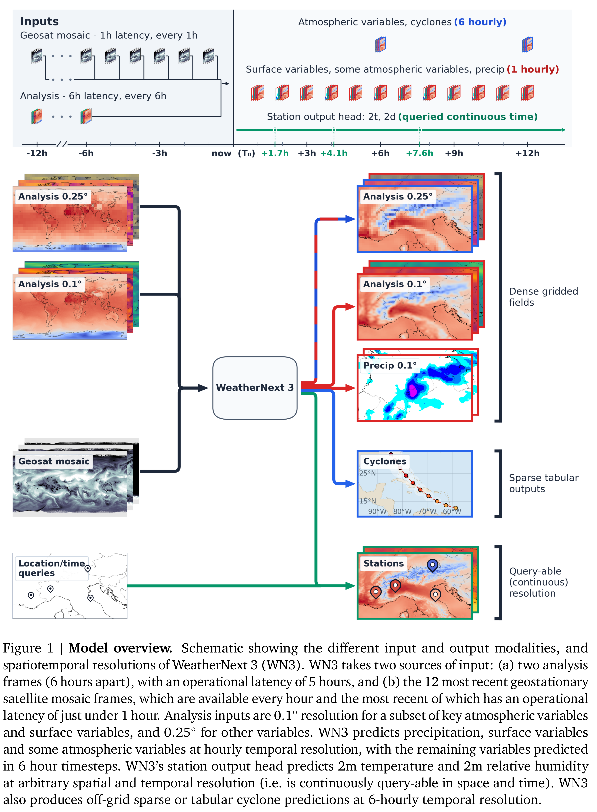
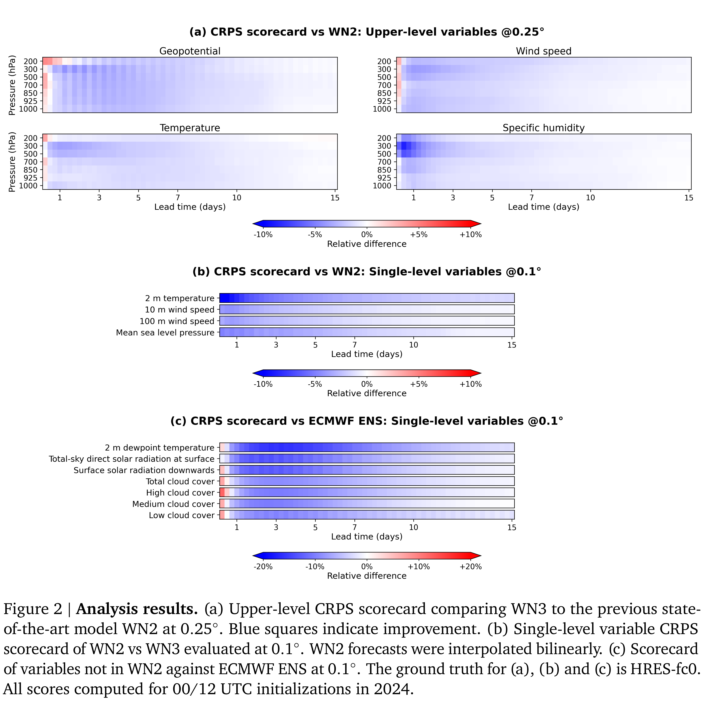

# WeatherNext 3: Increasing Resolution and Performance of Global Weather Models with Raw Observations

[Official source](https://arxiv.org/abs/2609.03582)

State-of-the-art AI weather models have shown impressive medium-range forecast skill and computational efficiency, but suffer two key shortcomings: their forecasts have lower spatial and temporal resolution than the best physics-based models and they are exclusively initialized with and trained on analysis data. As a result, they cannot directly make use of observations, and any biases in the analysis are inherited by the forecast. WeatherNext 3 addresses these shortcomings and establishes a new state-of-the-art for probabilistic medium-range forecasting skill. First, WeatherNext 3 generates new forecasts every hour (rather than every 6 hours like traditional global models) by ingesting low-latency geostationary satellite data. Second, WeatherNext 3’s temporal and spatial resolution are on par with physics-based global models, with hourly time steps and 0.1◦ resolution for single-level variables, including solar radiation and cloud cover. Third, WeatherNext 3 moves beyond traditional analysis variables by learning to predict satellite-derived precipitation estimates, as well as tropical cyclone and station observations. Modelling sparse station data allows WeatherNext 3 to make 2m temperature and dewpoint predictions at any location and time, conditioned on local geographical features, with substantially lower error than competing global models, even when evaluated against unseen stations. Together, WeatherNext 3’s capabilities move operational AI-based weather forecasting beyond emulating the traditionally distinct stages of data assimilation, forecasting and post-processing, which helps to further push the frontier of performance and granularity for global weather prediction.

Figure 1 | Model overview. Schematic showing the different input and output modalities, and spatiotemporal resolutions of WeatherNext 3 (WN3). WN3 takes two sources of input: (a) two analysis frames (6 hours apart), with an operational latency of 5 hours, and (b) the 12 most recent geostationary satellite mosaic frames, which are available every hour and the most recent of which has an operational latency of just under 1 hour. Analysis inputs are 0.1◦resolution for a subset of key atmospheric variables and surface variables, and 0.25◦for other variables. WN3 predicts precipitation, surface variables and some atmospheric variables at hourly temporal resolution, with the remaining variables predicted in 6 hour timesteps. WN3’s station output head predicts 2m temperature and 2m relative humidity at arbitrary spatial and temporal resolution (i.e. is continuously query-able in space and time). WN3 also produces off-grid sparse or tabular cyclone predictions at 6-hourly temporal resolution.

p. 2

Figure 2 | Analysis results. (a) Upper-level CRPS scorecard comparing WN3 to the previous state-of-the-art model WN2 at 0.25◦. Blue squares indicate improvement. (b) Single-level variable CRPS scorecard of WN2 vs WN3 evaluated at 0.1◦. WN2 forecasts were interpolated bilinearly. (c) Scorecard of variables not in WN2 against ECMWF ENS at 0.1◦. The ground truth for (a), (b) and (c) is HRES-fc0. All scores computed for 00/12 UTC initializations in 2024.

p. 11
