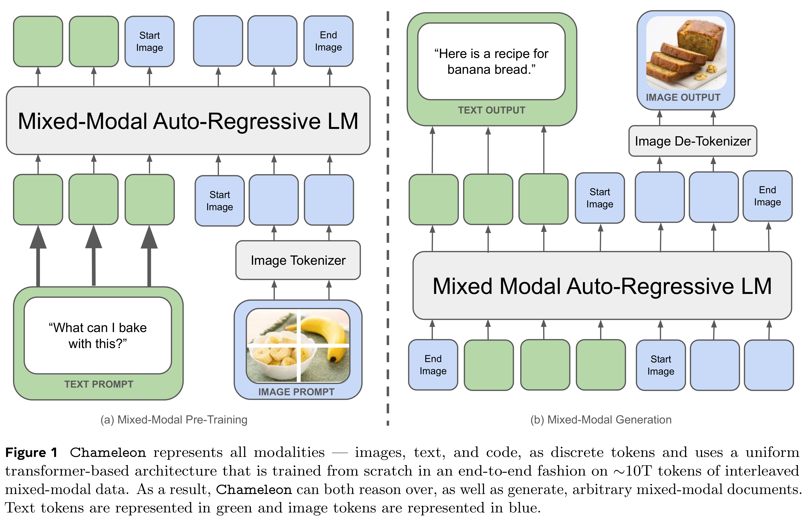
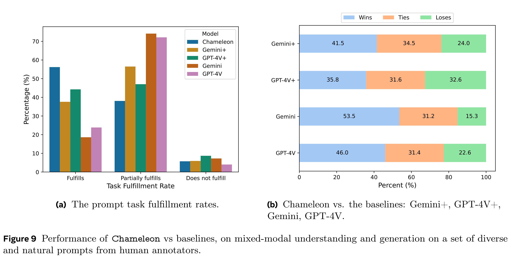

# Chameleon: Mixed-Modal Early-Fusion Foundation Models

[Official source](https://arxiv.org/abs/2405.09818)

We present Chameleon, a family of early-fusion token-based mixed-modal models capable of under- standing and generating images and text in any arbitrary sequence. We outline a stable training approach from inception, an alignment recipe, and an architectural parameterization tailored for the early-fusion, token-based, mixed-modal setting. The models are evaluated on a comprehensive range of tasks, including visual question answering, image captioning, text generation, image generation, and long-form mixed modal generation. Chameleon demonstrates broad and general capabilities, including state-of-the-art performance in image captioning tasks, outperforms Llama-2 in text-only tasks while being competitive with models such as Mixtral 8x7B and Gemini-Pro, and performs non-trivial image generation, all in a single model. It also matches or exceeds the performance of much larger models, including Gemini Pro and GPT-4V, according to human judgments on a new long-form mixed-modal generation evaluation, where either the prompt or outputs contain mixed sequences of both images and text. Chameleon marks a significant step forward in a unified modeling of full multimodal documents.

Figure 1 Chameleon represents all modalities — images, text, and code, as discrete tokens and uses a uniform transformer-based architecture that is trained from scratch in an end-to-end fashion on ∼10T tokens of interleaved mixed-modal data. As a result, Chameleon can both reason over, as well as generate, arbitrary mixed-modal documents. Text tokens are represented in green and image tokens are represented in blue.

p. 2

Figure 9 Performance of Chameleon vs baselines, on mixed-modal understanding and generation on a set of diverse and natural prompts from human annotators.

p. 12
