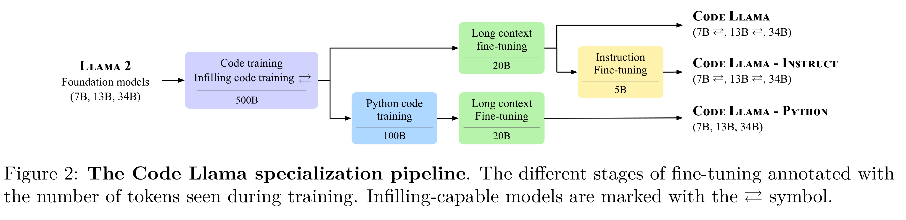
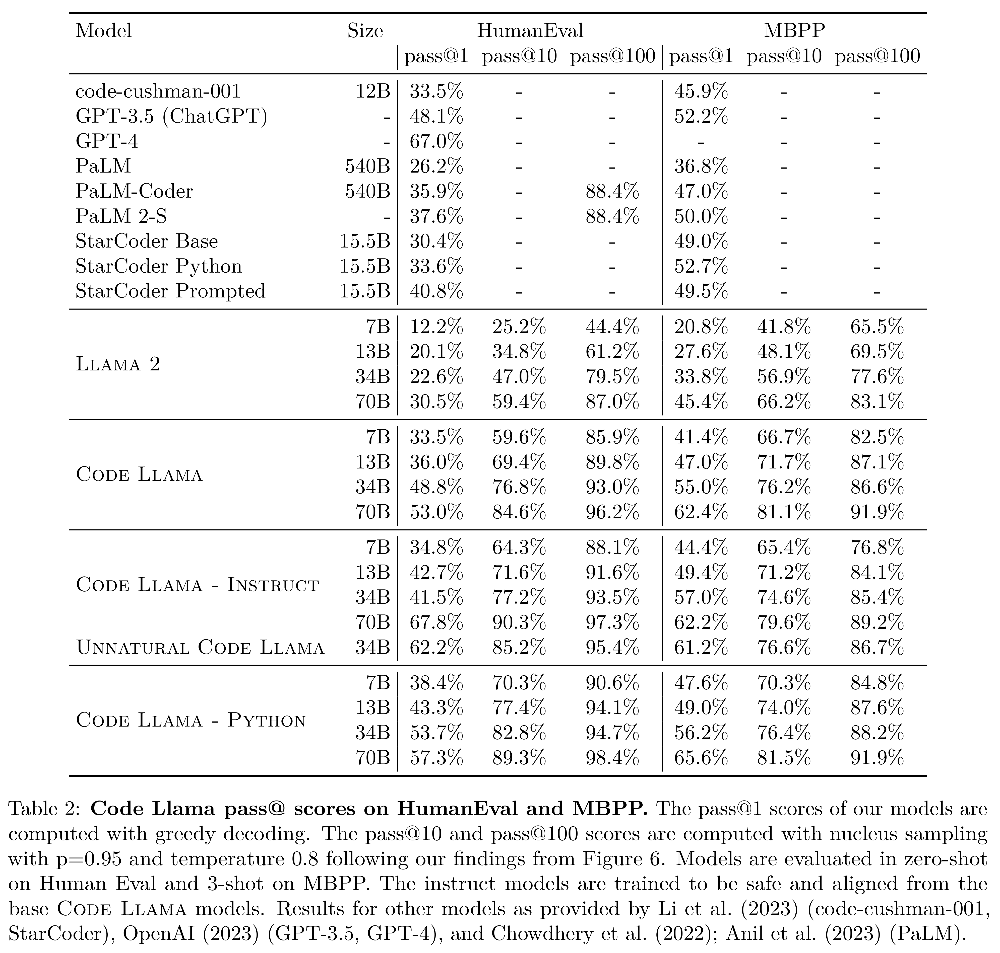

# Code Llama: Open Foundation Models for Code

[Official source](https://arxiv.org/abs/2308.12950)

## Abstract

We release Code Llama, a family of large language models for code based onLlama 2 providing state-of-the-art performance among open models, infilling capabilities, support for large input contexts, and zero-shot instruction following ability for programming tasks. We provide multiple flavors to cover a wide range of applications: foundation models (Code Llama), Python specializations (Code Llama - Python ), and instruction-following models (Code Llama - Instruct ) with 7B, 13B, 34B, and 70B parameters each. These models are trained on sequences of 16k tokens and show improvements on inputs with up to 100k tokens. The 7B, 13B and 70BCode Llama and Code Llama - Instruct variants support infilling based on surrounding content.Code Llama reaches state-of-the-art performance among open models on several code benchmarks, with scores of up to 67% and 65% on HumanEval and MBPP, respectively. Notably,Code Llama - Python 7B outperforms Llama 2 70B on HumanEval and MBPP, and all our models outperform every other publicly available model on MultiPL-E. We releaseCode Llama under a permissive license that allows for both research and commercial use.1

Figure 2: The Code Llama specialization pipeline. The different stages of fine-tuning annotated with the number of tokens seen during training. Infilling-capable models are marked with the ⇄symbol.

p. 3

Table 2: Code Llama pass@ scores on HumanEval and MBPP. The pass@1 scores of our models are computed with greedy decoding. The pass@10 and pass@100 scores are computed with nucleus sampling with p=0.95 and temperature 0.8 following our findings from Figure 6. Models are evaluated in zero-shot on Human Eval and 3-shot on MBPP. The instruct models are trained to be safe and aligned from the base Code Llama models. Results for other models as provided by Li et al. (2023) (code-cushman-001, StarCoder), OpenAI (2023) (GPT-3.5, GPT-4), and Chowdhery et al. (2022); Anil et al. (2023) (PaLM).

p. 6
