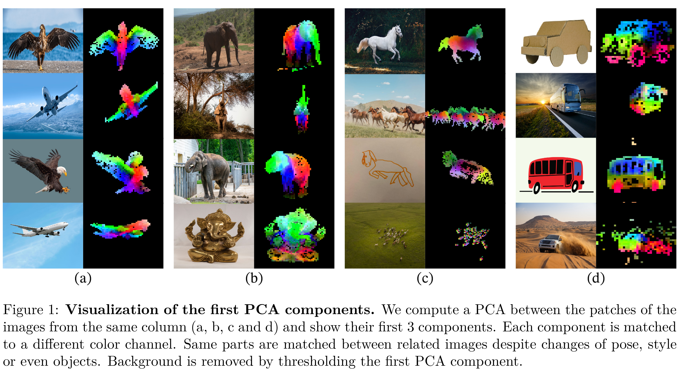
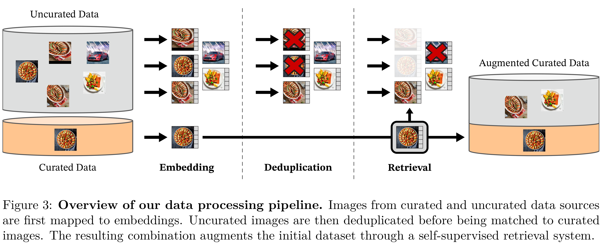

# DINOv2: Learning Robust Visual Features without Supervision

[Official source](https://arxiv.org/abs/2304.07193)

## Abstract

The recent breakthroughs in natural language processing for model pretraining on large quantities of data have opened the way for similar foundation models in computer vision. These models could greatly simplify the use of images in any system by producing general- purpose visual features, i.e., features that work across image distributions and tasks without finetuning. This work shows that existing pretraining methods, especially self-supervised methods, can produce such features if trained on enough curated data from diverse sources. We revisit existing approaches and combine different techniques to scale our pretraining in terms of data and model size. Most of the technical contributions aim at accelerating and stabilizing the training at scale. In terms of data, we propose an automatic pipeline to build a dedicated, diverse, and curated image dataset instead of uncurated data, as typically done in the self-supervised literature. In terms of models, we train a ViT model (Dosovitskiy et al., 2021) with 1B parameters and distill it into a series of smaller models that surpass the best available general-purpose features, OpenCLIP (Ilharco et al., 2021) on most of the benchmarks at image and pixel levels.

Figure 1: Visualization of the first PCA components. We compute a PCA between the patches of the
images from the same column (a, b, c and d) and show their first 3 components. Each component is matched
to a different color channel. Same parts are matched between related images despite changes of pose, style
or even objects. Background is removed by thresholding the first PCA component.

p. 2

Figure 3: Overview of our data processing pipeline. Images from curated and uncurated data sources
are first mapped to embeddings. Uncurated images are then deduplicated before being matched to curated
images. The resulting combination augments the initial dataset through a self-supervised retrieval system.

p. 4
