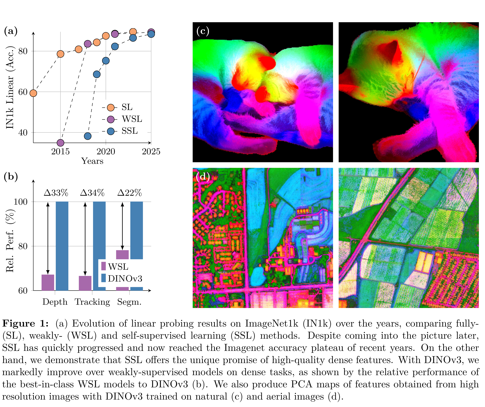
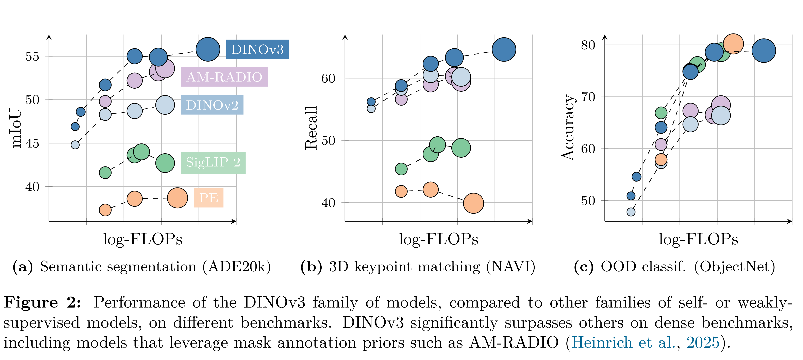
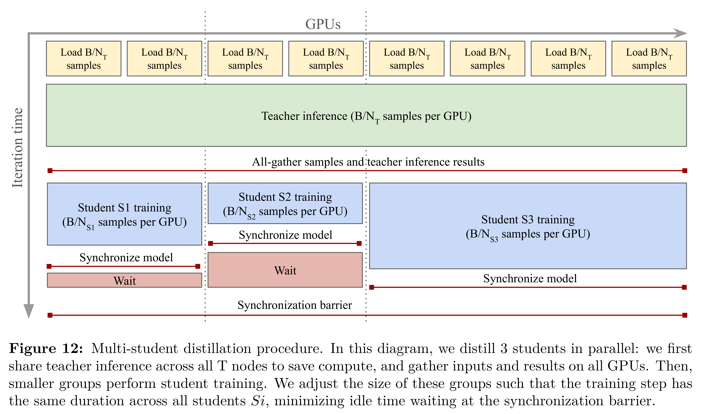

# DINOv3

[Official source](https://arxiv.org/abs/2508.10104)

## Abstract

Self-supervised learning holds the promise of eliminating the need for manual data annota- tion, enabling models to scale effortlessly to massive datasets and larger architectures. By not being tailored to specific tasks or domains, this training paradigm has the potential to learn visual representations from diverse sources, ranging from natural to aerial images— using a single algorithm. This technical report introduces DINOv3, a major milestone toward realizing this vision by leveraging simple yet effective strategies. First, we leverage the benefit of scaling both dataset and model size by careful data preparation, design, and optimization. Second, we introduce a new method called Gram anchoring, which effectively addresses the known yet unsolved issue of dense feature maps degrading during long training schedules. Finally, we apply post-hoc strategies that further enhance our models’ flexibility with respect to resolution, model size, and alignment with text. As a result, we present a versatile vision foundation model that outperforms the specialized state of the art across a broad range of settings, without fine-tuning. DINOv3 produces high-quality dense features that achieve outstanding performance on various vision tasks, significantly surpassing pre- vious self- and weakly-supervised foundation models. We also share the DINOv3 suite of vision models, designed to advance the state of the art on a wide spectrum of tasks and data by providing scalable solutions for diverse resource constraints and deployment scenarios.

Figure 1: (a) Evolution of linear probing results on ImageNet1k (IN1k) over the years, comparing fully- (SL), weakly- (WSL) and self-supervised learning (SSL) methods. Despite coming into the picture later, SSL has quickly progressed and now reached the Imagenet accuracy plateau of recent years. On the other hand, we demonstrate that SSL offers the unique promise of high-quality dense features. With DINOv3, we markedly improve over weakly-supervised models on dense tasks, as shown by the relative performance of the best-in-class WSL models to DINOv3 (b). We also produce PCA maps of features obtained from high resolution images with DINOv3 trained on natural (c) and aerial images (d).

p. 2

Figure 2: Performance of the DINOv3 family of models, compared to other families of self- or weakly- supervised models, on different benchmarks. DINOv3 significantly surpasses others on dense benchmarks, including models that leverage mask annotation priors such as AM-RADIO (Heinrich et al., 2025).

p. 3

Figure 12: Multi-student distillation procedure. In this diagram, we distill 3 students in parallel: we first share teacher inference across all T nodes to save compute, and gather inputs and results on all GPUs. Then, smaller groups perform student training. We adjust the size of these groups such that the training step has the same duration across all students Si, minimizing idle time waiting at the synchronization barrier.

p. 16
