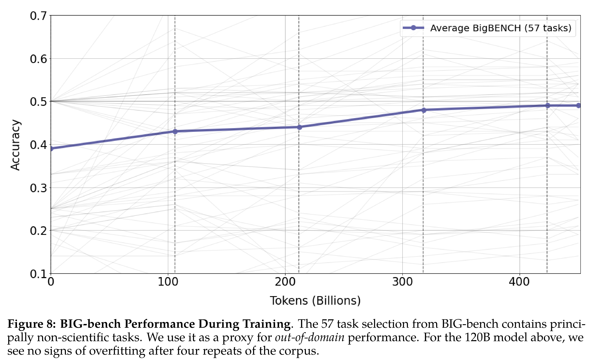

# Galactica: A Large Language Model for Science

[Official source](https://arxiv.org/abs/2211.09085)

## Abstract

Information overload is a major obstacle to scientific progress. The explosive growth in scientific literature and data has made it ever harder to discover useful insights in a large mass of information. Today scientific knowledge is accessed through search engines, but they are unable to organize scientific knowledge alone. In this paper we introduce Galactica: a large language model that can store, combine and reason about scientific knowledge. We train on a large scientific corpus of papers, reference material, knowledge bases and many other sources. We outperform existing models on a range of scientific tasks. On technical knowledge probes such as LaTeX equations, Galactica outperforms the latest GPT-3 by 68.2% versus 49.0%. Galactica also performs well on reasoning, outperforming Chinchilla on mathematical MMLU by 41.3% to 35.7%, and PaLM 540B on MATH with a score of 20.4% versus 8.8%. It also sets a new state-of-the-art on downstream tasks such as PubMedQA and MedMCQA dev of 77.6% and 52.9%. And despite not being trained on a general corpus, Galactica outperforms BLOOM and OPT-175B on BIG-bench. We believe these results demonstrate the potential for language models as a new interface for science. We open source the model for the benefit of the scientific community1.

Figure 8: BIG-bench Performance During Training. The 57 task selection from BIG-bench contains principally non-scientific tasks. We use it as a proxy for out-of-domain performance. For the 120B model above, we see no signs of overfitting after four repeats of the corpus.

p. 12
