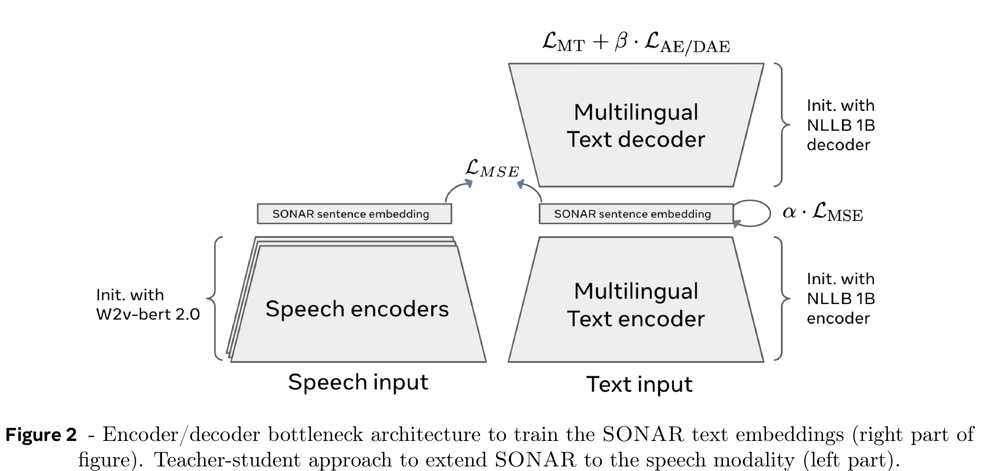
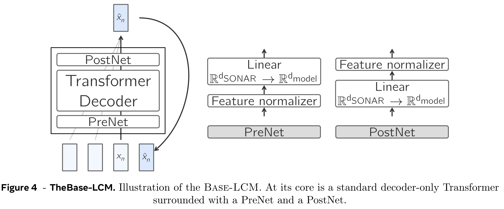
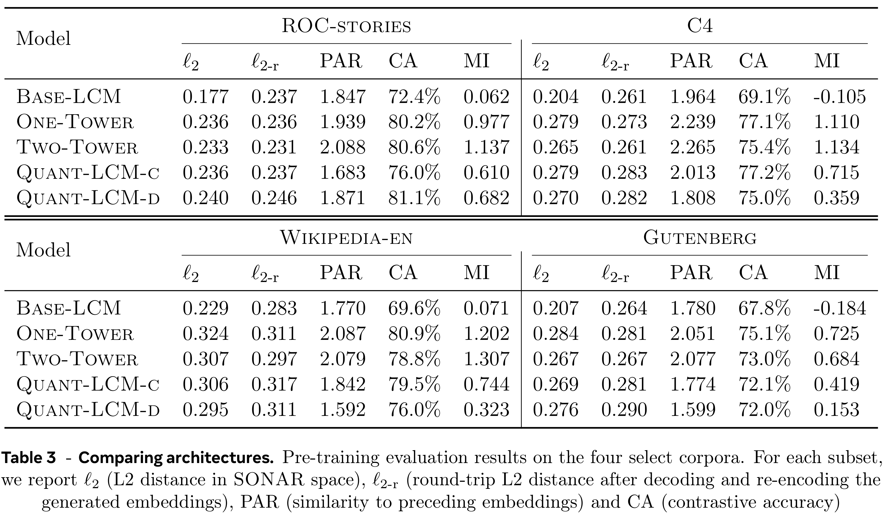

# Large Concept Models: Language Modeling in a Sentence Representation Space

[Official source](https://arxiv.org/abs/2412.08821)

## 1 Introduction

Large Language models (LLMs) are dominating current research in natural language processing, and with their recent extension to more modalities, namely images, video and speech, they seem to be considered as the de-facto technique to follow to approach human intelligence. LLMs achieve indeed impressive performance on a large variety of tasks, such as providing detailed answers for general knowledge questions, helping in performing long document analysis, or drafting different types of messages, and writing or debugging code. Building an LLM from scratch requires access to

enormous computational resources to process ever larger amounts of data and train models, the size of which now exceeds four hundred billion parameters. Knowledge acquisition in LLMs is heavily data-driven and extending them to more languages or modalities usually requires injecting additional (synthetic) data to cover them.

The landscape of available LLMs can be structured into open models such as Llama (The Llama3 team, 2024), Mistral (Jiang et al., 2024), Bloom (BigScience Workshop, 2023) or Falcon (Almazrouei et al., 2023), on the one hand, and closed models such as Gemini (Gemini Team Google, 2024), GPT (OpenAI, 2024) or Claude (Anthropic, 2024), on the other. It is striking that all these models are based on the same underlying architecture: a transformer-based, decoder-only language model, which is pretrained to predict the next token, given a long context of preceding tokens. Despite the undeniable success of LLMs and continued progress, all current LLMs miss a crucial characteristic of human intelligence: explicit reasoning and planning at multiple levels of abstraction. The human brain does not operate at the word level only. We usually have a top-down process to solve a complex task or compose a long document: we first plan at a higher level the overall structure, and then step-by-step, add details at lower levels of abstraction. One may argue that LLMs are implicitly learning a hierarchical representation, but we stipulate that models with an explicit hierarchical architecture are better suited to create coherent long-form output.

Imagine a researcher giving a fifteen-minute talk. In such a situation, researchers do not usually prepare detailed speeches by writing out every single word they will pronounce. Instead, they outline a flow of higher-level ideas they want to communicate. Should they give the same talk multiple times, the actual words being spoken may differ, the talk could even be given in different languages, but the flow of higher-level abstract ideas will remain the same. Similarly, when writing a research paper or essay on a specific topic, humans usually start by preparing an outline that structures the whole document into sections, which they then refine iteratively. Humans also detect and remember dependencies between the different parts of a longer document at an abstract level. If we expand on our previous research writing example, keeping track of dependencies means that we need to provide results for each of the experiment mentioned in the introduction. Finally, when processing and analyzing information, humans rarely consider every single word in a large document. Instead, we use a hierarchical approach: we remember which part of a long document we should search to find a specific piece of information.

To the best of our knowledge, this explicit hierarchical structure of information processing and generation, at an abstract level, independent of any instantiation in a particular language or modality, cannot be found in any of the current LLMs. In this work, we present a new approach which moves away from processing at the token level and closer to (hierarchical) reasoning in an abstract embedding space. This abstract embedding space is designed to be independent of the language or modality in which the content is expressed; in other words, we aim to model the underlying reasoning process at a purely semantic level, not its instantiation in a specific language. In order to verify our approach, we limit our study to two levels of abstraction: subword tokens and concepts. We define a concept as an abstract atomic idea. In practice, a concept would often correspond to a sentence in a text document, or an equivalent speech utterance. We posit that a sentence is an appropriate unit to achieve language independence, in opposition to single words. This is in sharp contrast to current LLMs techniques which are heavily English centric and token based.

Our fundamental idea could be based on any fixed-size sentence embedding space for which an encoder and decoder are available. In particular, we could aim to train a new embedding space specifically optimized to our reasoning architecture. In this work, we chose an existing and freely available sentence embedding, named SONAR (Duquenne et al., 2023b). SONAR supports text

Figure 1 - Left: visualization of reasoning in an embedding space of concepts (task of summarization). Right: fundamental architecture of an Large Concept Model (LCM). ⋆: concept encoder and decoder are frozen.

input and output in 200 languages, speech input in 76 languages, and speech output in English. We discuss the constraints and impact of this choice in Section 2.1, and share some ideas on alternative embedding spaces in Section 6.

Figure 1-left visualizes reasoning in an embedding space with the example of a summarization task, which is materialized by a function on the embedding space, mapping five concept representations into two. Figure 1-right summarizes the overall architecture and processing flow. The input is first segmented into sentences, and each one is encoded with SONAR to achieve a sequence of concepts, i.e., sentence embeddings. This sequence of concepts is then processed by a Large Concept Model (LCM) to generate at the output a new sequence of concepts. Finally, the generated concepts are decoded by SONAR into a sequence of subwords. The encoder and decoder are fixed and are not trained. It is important to highlight that the unchanged sequence of concepts at the output of the LCM can be decoded into other languages or modalities without performing again the whole reasoning process. In the same spirit, a particular reasoning operation such as summarization can be performed in a zero-shot setting on input in any language or modality, since it solely operates on concepts. To summarize, the LCM neither has information on the input language or modality nor generates output in a particular language or modality. We explore multiple architectures to train the LCM, in particular several variants of diffusion. Finally, we envision an additional level of abstraction beyond concepts which could correspond to a short description of a paragraph or small section. In Section 4.3 we report initial ideas on how conditioning and predicting such higher-level representations can improve consistency of output generated by an LCM.

To some extent, the LCM architecture resembles the Jepa approach (LeCun, 2022) that also aims to predict the representation of the next observation in an embedding space. However, unlike Jepa that places more emphasis on learning a representation space in a self-supervised way, the LCM focuses on accurate prediction in the existing embedding space.

The mains characteristics of our generic Large Concept Model approach are as follows:

– We model the underlying reasoning process, not its instantiation in a particular language.

– The LCM can be trained, i.e. acquire knowledge, on all languages and modalities at once,

promising scalability in an unbiased way.

– Better readability of long-form output by a human.

– Facilitates local interactive edits by a user.

– The complexity of a vanilla transformer model increases quadratically with the sequence length. This makes handling of large context windows challenging and several techniques have been developed to alleviate this problem, e.g., sparse attention (Child et al., 2019) or LSH attention (Kitaev et al., 2020). Our LCM operates on sequences which are at least an order of magnitude shorter.1

– Independently of the language or modality the LCM is pre-trained and fine-tuned on, it can be applied to any language and modality supported by the SONAR encoders, without the need of additional data or fine-tuning. We report results for multiple languages in the text modality.

– Unlike multimodal LLMs that can suffer from modality competition (Aghajanyan et al., 2023; Chameleon team, 2024), concept encoders and decoders can be independently developed and optimized without any competition or interference.

– New languages or modalities can be easily added for an existing system.

The goal of this paper is to provide a proof of concept of this high-level vision of an alternative architecture to current best practice in language modeling. In the next section we present the main design principles of our models and discuss several variants to build and train a Large Concept Model. We discuss several designs to implement diffusion approaches with concept embeddings and carefully study noise scheduling. This section is completed by a compute complexity comparison with token-based LLMs. Section 3 is dedicated to the analysis of a larger 7B parameter model. We discuss challenges when instruction fine-tuning this model on multiple generative tasks, and provide a comparison with existing LLMs of comparable size. The paper concludes with a discussion of related work, the current limitations and perspectives of our approach.

To foster research in this area, we make our LCM training code2 as well as SONAR encoders and decoders3 for up to 200 languages and multiple modalities freely available.

Figure 2 - Encoder/decoder bottleneck architecture to train the SONAR text embeddings (right part of

p. 5

Figure 4 - TheBase-LCM. Illustration of the Base-LCM. At its core is a standard decoder-only Transformer

p. 8

Table 3 - Comparing architectures. Pre-training evaluation results on the four select corpora. For each subset,
we report ℓ2 (L2 distance in SONAR space), ℓ2-r (round-trip L2 distance after decoding and re-encoding the

p. 19
