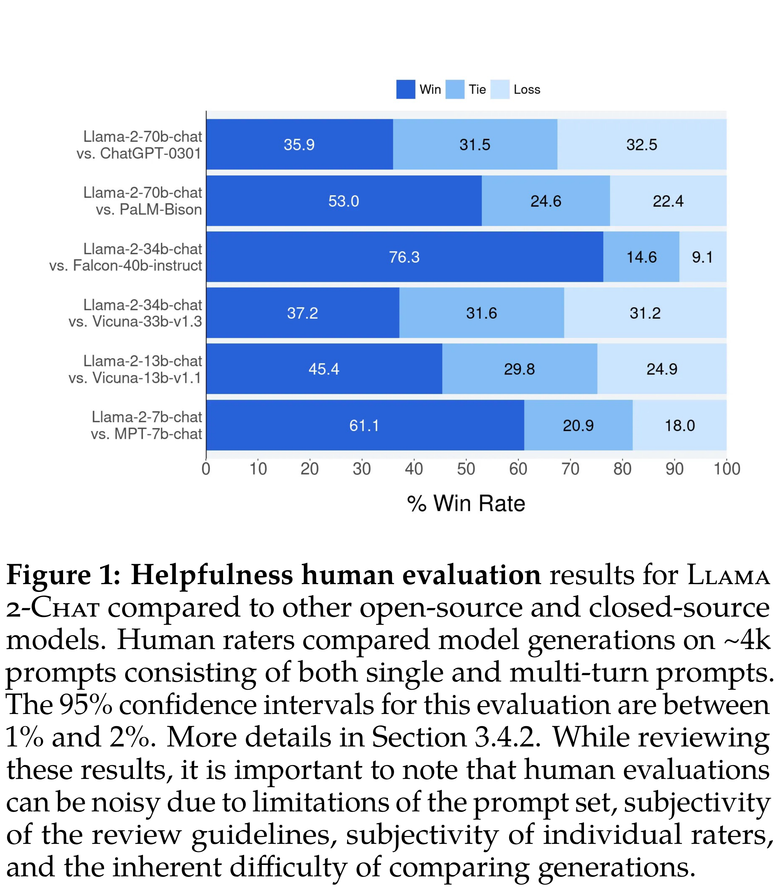
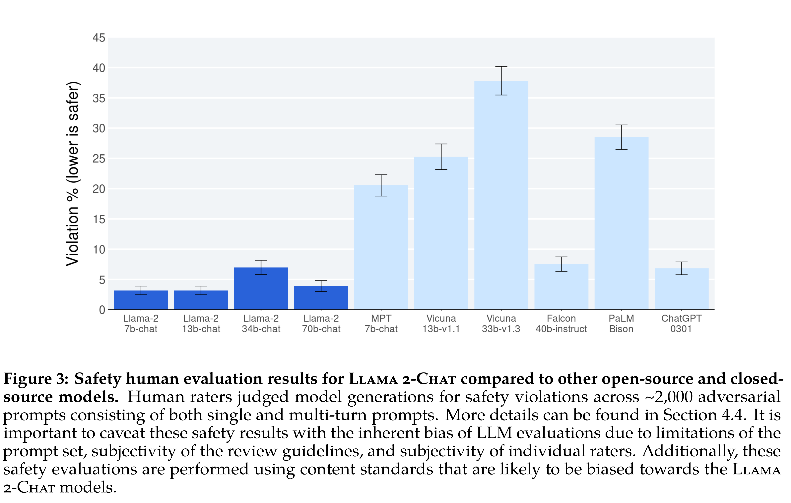
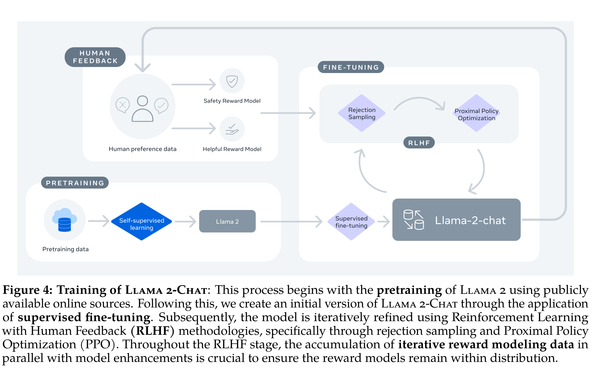

# Llama 2: Open Foundation and Fine-Tuned Chat Models

[Official source](https://arxiv.org/abs/2307.09288)

## Abstract

In this work, we develop and release Llama 2, a collection of pretrained and fine-tuned large language models (LLMs) ranging in scale from 7 billion to 70 billion parameters. Our fine-tuned LLMs, called Llama 2-Chat, are optimized for dialogue use cases. Our models outperform open-source chat models on most benchmarks we tested, and based on our human evaluations for helpfulness and safety, may be a suitable substitute for closed-source models. We provide a detailed description of our approach to fine-tuning and safety improvements of Llama 2-Chat in order to enable the community to build on our work and contribute to the responsible development of LLMs.

Contributions for all the authors can be found in Section A.1.

Figure 1: Helpfulness human evaluation results for Llama 2-Chat compared to other open-source and closed-source models. Human raters compared model generations on ~4k prompts consisting of both single and multi-turn prompts. The 95% confidence intervals for this evaluation are between 1% and 2%. More details in Section 3.4.2. While reviewing these results, it is important to note that human evaluations can be noisy due to limitations of the prompt set, subjectivity of the review guidelines, subjectivity of individual raters, and the inherent difficulty of comparing generations.

p. 3

Figure 3: Safety human evaluation results for Llama 2-Chat compared to other open-source and closed-source models. Human raters judged model generations for safety violations across ~2,000 adversarial prompts consisting of both single and multi-turn prompts. More details can be found in Section 4.4. It is important to caveat these safety results with the inherent bias of LLM evaluations due to limitations of the prompt set, subjectivity of the review guidelines, and subjectivity of individual raters. Additionally, these safety evaluations are performed using content standards that are likely to be biased towards the Llama 2-Chat models.

p. 4

Figure 4: Training of Llama 2-Chat: This process begins with the pretraining of Llama 2 using publicly available online sources. Following this, we create an initial version of Llama 2-Chat through the application of supervised fine-tuning. Subsequently, the model is iteratively refined using Reinforcement Learning with Human Feedback (RLHF) methodologies, specifically through rejection sampling and Proximal Policy Optimization (PPO). Throughout the RLHF stage, the accumulation of iterative reward modeling data in parallel with model enhancements is crucial to ensure the reward models remain within distribution.

p. 5
