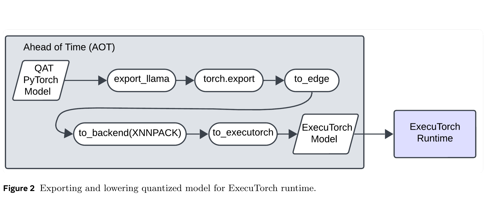
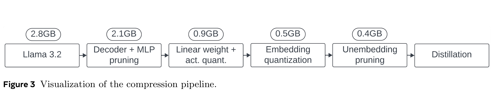
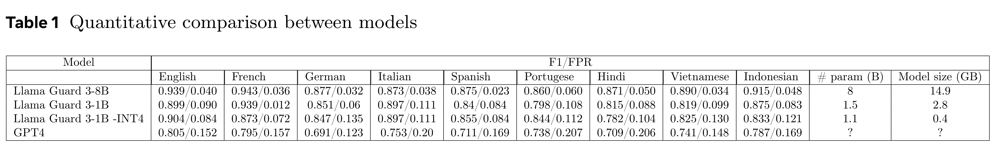

# Llama Guard 3-1B-INT4: Compact and Efficient Safeguard for Human-AI Conversations

[Official source](https://arxiv.org/abs/2411.17713)

This paper presents Llama Guard 3-1B-INT4, a compact and efficient Llama Guard model, which has been open-sourced to the community during Meta Connect 2024. We demonstrate that Llama Guard 3-1B-INT4 can be deployed on resource-constrained devices, achieving a throughput of at least 30 tokens per second and a time-to-first-token of 2.5 seconds or less on a commodity Android mobile CPU. Notably, our experiments show that Llama Guard 3-1B-INT4 attains comparable or superior safety moderation scores to its larger counterpart, Llama Guard 3-1B, despite being approximately 7 times smaller in size (440MB).

Figure 2 Exporting and lowering quantized model for ExecuTorch runtime.

p. 3

Figure 3 Visualization of the compression pipeline.

p. 4

Table 1 Quantitative comparison between models

p. 6
