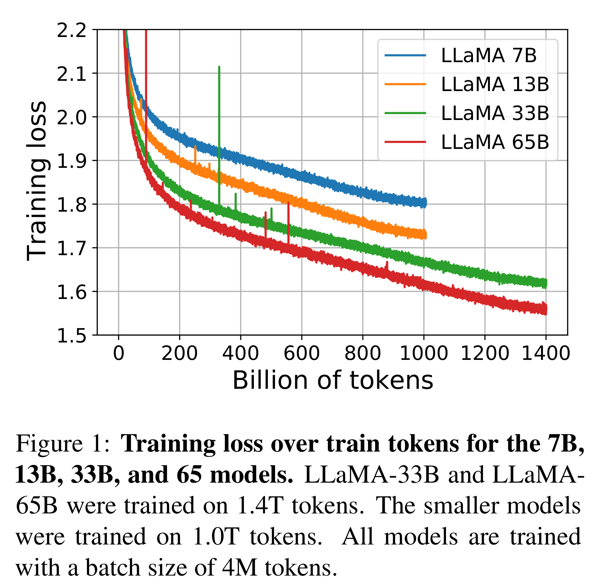

# LLaMA: Open and Efficient Foundation Language Models

[Official source](https://arxiv.org/abs/2302.13971)

## Abstract

We introduce LLaMA, a collection of foundation language models ranging from 7B to 65B parameters. We train our models on trillions of tokens, and show that it is possible to train state-of-the-art models using publicly available datasets exclusively, without resorting to proprietary and inaccessible datasets. In particular, LLaMA-13B outperforms GPT-3 (175B) on most benchmarks, and LLaMA- 65B is competitive with the best models, Chinchilla-70B and PaLM-540B. We release all our models to the research community1.

Figure 1: Training loss over train tokens for the 7B, 13B, 33B, and 65 models. LLaMA-33B and LLaMA-65B were trained on 1.4T tokens. The smaller models were trained on 1.0T tokens. All models are trained with a batch size of 4M tokens.

p. 3
