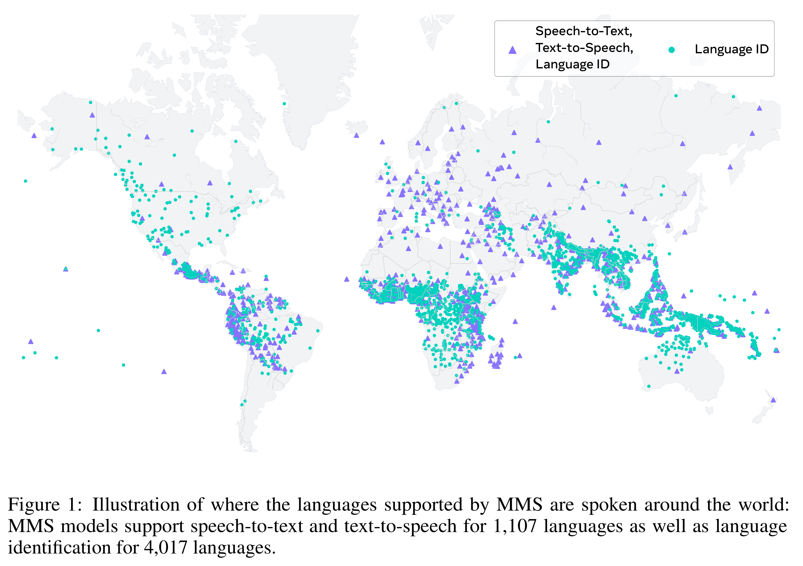
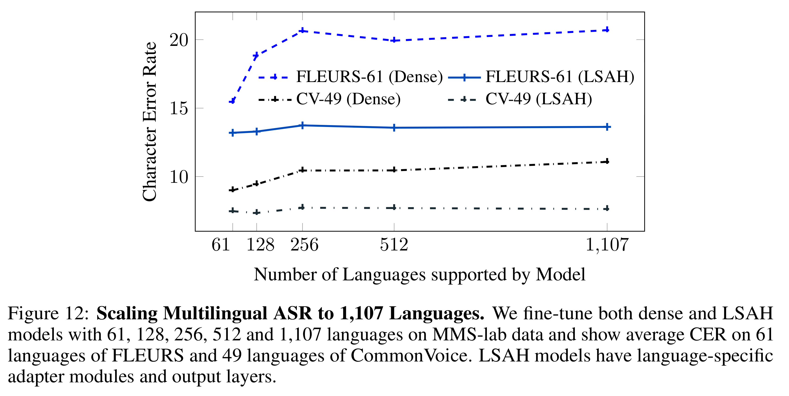

# Scaling Speech Technology to 1,000+ Languages

[Official source](https://arxiv.org/abs/2305.13516)

## Abstract

Expanding the language coverage of speech technology has the potential to im- prove access to information for many more people. However, current speech technology is restricted to about one hundred languages which is a small frac- tion of the over 7,000 languages spoken around the world. The Massively Mul- tilingual Speech (MMS) project increases the number of supported languages by 10-40x, depending on the task. The main ingredients are a new dataset based on readings of publicly available religious texts and effectively leverag- ing self-supervised learning. We built pre-trained wav2vec 2.0 models covering 1,406 languages, a single multilingual automatic speech recognition model for 1,107 languages, speech synthesis models for the same number of languages, as well as a language identification model for 4,017 languages. Experiments show that our multilingual speech recognition model more than halves the word er- ror rate of Whisper on 54 languages of the FLEURS benchmark while being trained on a small fraction of the labeled data. The MMS models are available at https://github.com/pytorch/fairseq/tree/master/examples/mms.

Figure 1: Illustration of where the languages supported by MMS are spoken around the world: MMS models support speech-to-text and text-to-speech for 1,107 languages as well as language identification for 4,017 languages.

p. 2

Figure 12: Scaling Multilingual ASR to 1,107 Languages. We fine-tune both dense and LSAH models with 61, 128, 256, 512 and 1,107 languages on MMS-lab data and show average CER on 61 languages of FLEURS and 49 languages of CommonVoice. LSAH models have language-specific adapter modules and output layers.

p. 16
