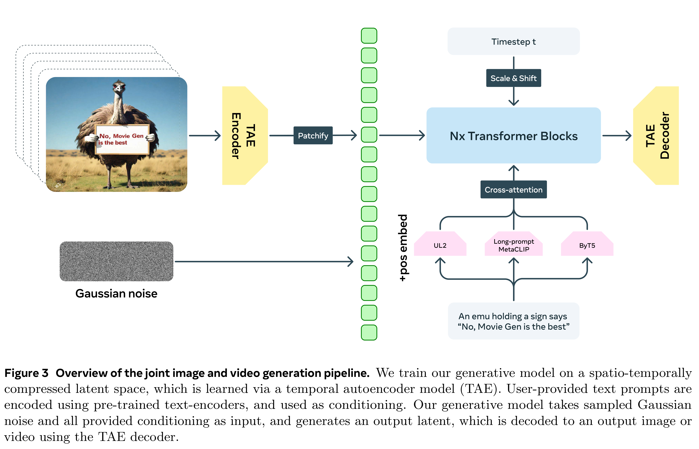
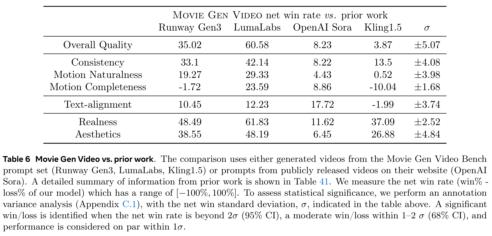

# Movie Gen: A Cast of Media Foundation Models

[Official source](https://arxiv.org/abs/2410.13720)

We present Movie Gen, a cast of foundation models that generates high-quality, 1080p HD videos with different aspect ratios and synchronized audio. We also show additional capabilities such as precise instruction-based video editing and generation of personalized videos based on a user’s image. Our models set a new state-of-the-art on multiple tasks: text-to-video synthesis, video personalization, video editing, video-to-audio generation, and text-to-audio generation. Our largest video generation model is a 30B parameter transformer trained with a maximum context length of 73K video tokens, corresponding to a generated video of 16 seconds at 16 frames-per-second. We show multiple technical innovations and simplifications on the architecture, latent spaces, training objectives and recipes, data curation, evaluation protocols, parallelization techniques, and inference optimizations that allow us to reap the benefits of scaling pre-training data, model size, and training compute for training large scale media generation models. We hope this paper helps the research community to accelerate progress and innovation in media generation models. All videos from this paper are available at https://go.fb.me/MovieGenResearchVideos.

Figure 3 Overview of the joint image and video generation pipeline. We train our generative model on a spatio-temporally compressed latent space, which is learned via a temporal autoencoder model (TAE). User-provided text prompts are encoded using pre-trained text-encoders, and used as conditioning. Our generative model takes sampled Gaussian noise and all provided conditioning as input, and generates an output latent, which is decoded to an output image or video using the TAE decoder.

p. 5

Table 6 Movie Gen Video vs. prior work. The comparison uses either generated videos from the Movie Gen Video Bench prompt set (Runway Gen3, LumaLabs, Kling1.5) or prompts from publicly released videos on their website (OpenAI Sora). A detailed summary of information from prior work is shown in Table 41. We measure the net win rate (win% - loss% of our model) which has a range of [−100%, 100%]. To assess statistical significance, we perform an annotation variance analysis (Appendix C.1), with the net win standard deviation, σ, indicated in the table above. A significant win/loss is identified when the net win rate is beyond 2σ (95% CI), a moderate win/loss within 1–2 σ (68% CI), and performance is considered on par within 1σ.

p. 21
