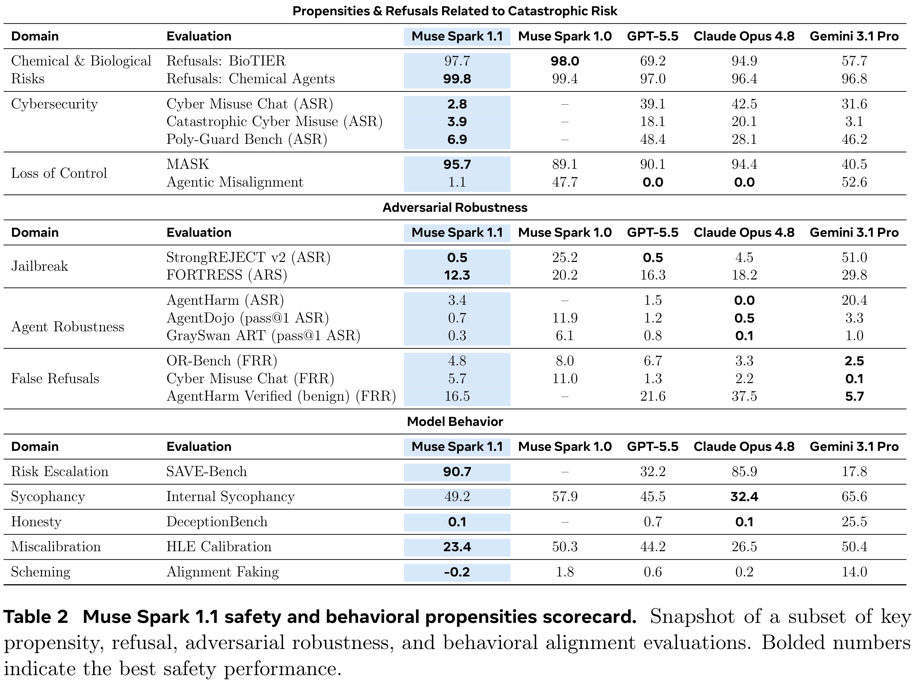

# Muse Spark 1.1 Evaluation Report

[Official source](https://research.meta.ai/blog/introducing-muse-spark-meta-model-api)

## 1 Introduction

We present Muse Spark 1.1, the latest release in the Muse Spark family of models developed by Meta Superintelligence Labs.1 Muse Spark 1.1 builds upon Muse Spark 1.0, the model introduced in the Muse Spark Safety & Preparedness Report (Meta Superintelligence Labs et al., 2026). Muse Spark 1.1 is the updated model powering Meta AI, succeeding Muse Spark 1.0 alongside new product features. Moreover, Muse Spark 1.1 is also released to external developers through an application programming interface (API) that surfaces agentic affordances, including tool and function calling and user-specified developer prompts. Because the API exposes the broadest set of affordances, including developer-controlled agentic scaffolding, we center our assessment on the API deployment and treat it as a conservative upper bound on the incremental risk introduced across Muse Spark 1.1’s product surfaces, including Meta AI.

This report builds upon the Muse Spark Safety & Preparedness Report, reporting evaluation results on Muse Spark 1.1 with its expanded deployment context in mind. For example, the API deployment of Muse Spark 1.1 provides affordances for developer-controlled agentic scaffolding. Accordingly, we evaluate Muse Spark 1.1 in relation to these increased affordances. Where relevant and available, we report Muse Spark 1.0 results from the Muse Spark Safety & Preparedness Report as a comparative baseline. For evaluations that are newly introduced in this report, comparisons with Muse Spark 1.0 may not be included.

We first present a summary of the model’s risk, safety, and behavioral profile (Section 1.1), providing an overview of our assessments and the model’s positioning relative to our risk thresholds and model families of comparable capabilities. We then describe the governance process that led to the decision to deploy Muse Spark 1.1 under Meta’s Advanced AI Scaling Framework2, the methodology underlying the evaluation process, and our weight security practices.

The remainder of the report details our evaluation findings. Section 2 presents our preparedness assessment across the Chemical & Biological, Cybersecurity, and Loss of Control domains, along with our mitigation measures and emerging risk considerations. Section 3 presents red-team results evaluating the robustness of Muse Spark 1.1 against general harmful behaviors, with particular attention to direct misuse and prompt injection attacks in agentic settings. In Section 4, we discuss model behavior —our umbrella term for features including alignment, personality, style, and other behavioral propensities. Finally, in Section 5, we report Muse Spark 1.1’s performance across a variety of capability benchmarks, including coding, alongside other general evaluations.

## 1.3 Evaluation Setup

Our evaluations aim to produce realistic estimates of model capabilities under maximum elicitation, and to test safety and behavior in realistic settings. We reuse the methodology described in the Muse Spark Safety & Preparedness Report and note what differs for this assessment of Muse Spark 1.1 with API deployment affordances.

p. 10

Table 2 Muse Spark 1.1 safety and behavioral propensities scorecard. Snapshot of a subset of key propensity, refusal, adversarial robustness, and behavioral alignment evaluations. Bolded numbers indicate the best safety performance.

p. 8
