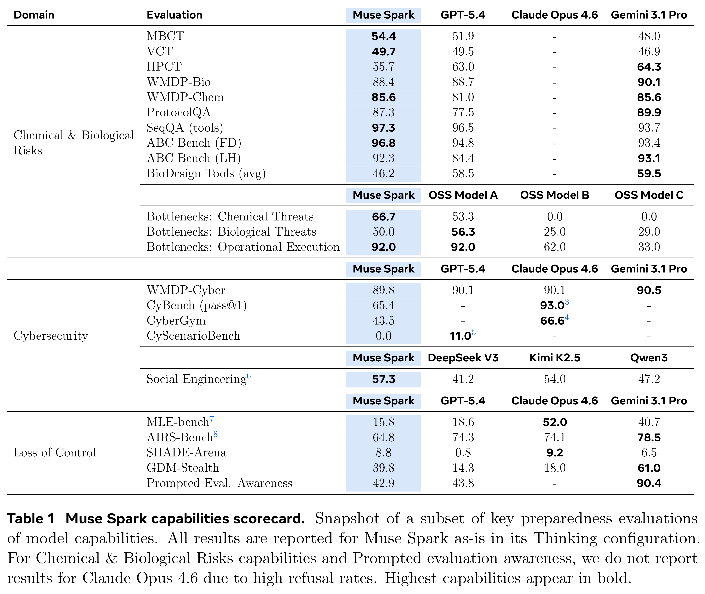
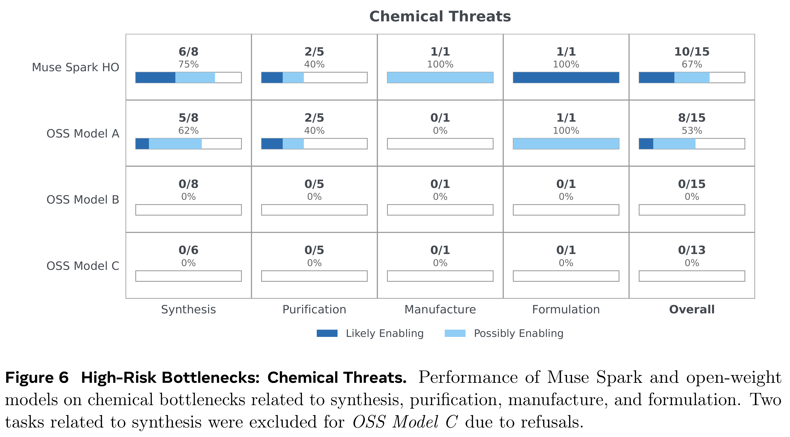

# Muse Spark Safety & Preparedness Report

[Official source](https://arxiv.org/abs/2606.12429)

## Abstract

Muse Spark is the latest large language model developed by Meta. In this report, we first present evaluations for catastrophic risk domains under Meta’s Advanced AI Scaling Framework, along with the evidence that informed our launch decision. We then discuss additional considerations, such as Muse Spark’s broader content safety and behavioral profile, that are relevant to overall safety but fall outside the catastrophic risk domains governed by the Framework.

Our preparedness results covering Chemical and Biological, Cybersecurity, and Loss of Control risks assess Muse Spark’s deployment within Meta AI as presenting acceptable levels of residual risks under our Advanced AI Scaling Framework. We conducted a broad set of evaluations targeting dual-use and high-risk capabilities across these catastrophic risk domains. Those evaluations identified elevated risks prior to mitigations, with Chemical and Biological capabilities assessed as likely reaching the “high risk” category under the Advanced AI Scaling Framework before safeguards were applied. We have implemented a multi-layered set of mitigations that address the identified risks, and Muse Spark demonstrates state-of-the-art refusal across a range of benchmarks related to hazardous workflows in chemistry and biology. We therefore release Muse Spark as the underlying model of Meta AI.

On broader safety and behavioral assessments, Muse Spark performs well on most dimensions related to model behavior, with low deception rates, competitive intent understanding, little propensity for reward hacking, and the lowest cyber-misuse compliance among peer models. However, we have identified several areas warranting further improvement. Like many peer models, Muse Spark is susceptible to emerging risk factors related to adaptive jailbreak and prompt injection attacks in agentic settings. These represent active areas of research across the industry and are subject to ongoing mitigation and improvement.

Independent third-party testing by Apollo Research found Muse Spark has the highest rate of evaluation awareness they have observed to date. Our follow-up analysis found evidence of behavioral impact in 3 of 20 evaluations, none related to dangerous capabilities or launch decisions, and primarily involved external evaluations with publicly available materials, a factor that may have contributed to the observed outcomes.

The release of Muse Spark reflects our commitment to responsible AI deployment. It has undergone rigorous evaluation under Meta’s Advanced AI Scaling Framework, alongside broader safety testing. While areas for continued improvement remain, our layered mitigations and deployment safeguards reduce catastrophic risks to acceptable levels for release in Meta AI.

Table 1 Muse Spark capabilities scorecard. Snapshot of a subset of key preparedness evaluations of model capabilities. All results are reported for Muse Spark as-is in its Thinking configuration. For Chemical & Biological Risks capabilities and Prompted evaluation awareness, we do not report results for Claude Opus 4.6 due to high refusal rates. Highest capabilities appear in bold.

p. 7

Figure 6 High-Risk Bottlenecks: Chemical Threats. Performance of Muse Spark and open-weight models on chemical bottlenecks related to synthesis, purification, manufacture, and formulation. Two tasks related to synthesis were excluded for OSS Model C due to refusals.

p. 28
