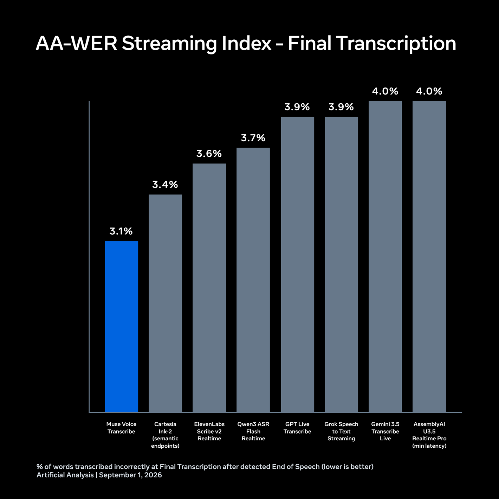
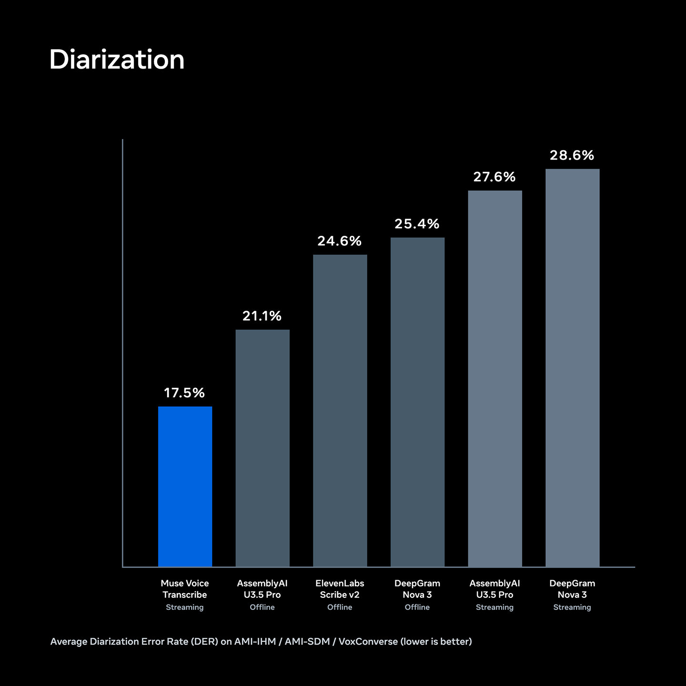

# Muse Voice Transcribe

[Official source](https://research.meta.ai/blog/introducing-muse-voice-transcribe)

We’re excited to introduce Muse Voice Transcribe, the first real-time audio perception model developed by Meta Superintelligence Labs.

Muse Voice Transcribe marks a first milestone in bringing our real-time voice models to you. It delivers real-time streaming ASR, diarization with 20+ speakers, and endpointing. It is multilingual with seamless code-switching and improves accuracy with language, keyword, and context biasing.

We rank first on Artificial Analysis on streaming speech-to-text and on public diarization benchmarks. Model inclusion and rankings as of September 1, 2026.

